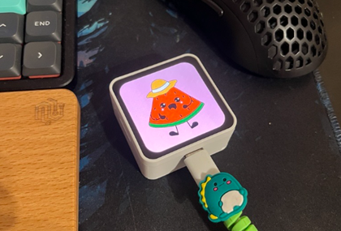

# Project: ESP32-S3 AMOLED Network Image Display



## 1. Project goal

Develop custom firmware for the Waveshare ESP32-S3-Touch-AMOLED-2.16 development board.

The device should function as a network-accessible image display. It should receive images over HTTP and render them on its 480×480 AMOLED display.

The firmware must be modular, maintainable and designed for future extensions (layers, animations, multiple image sources, WebSocket communication, etc.).

Do not implement future features prematurely. The initial goal is a reliable, minimal image display device.

## 2. Hardware

Target board: Waveshare ESP32-S3-Touch-AMOLED-2.16

Verified hardware information:

- MCU: ESP32-S3 (QFN56), revision 0.2
- CPU: Dual Core, 240 MHz
- Flash: 16 MB
- PSRAM: 8 MB (AP_3v3)
- Wi-Fi: 2.4 GHz
- Bluetooth: BLE 5
- Display: 2.16-inch AMOLED, 480×480, 16.7M colors
- USB: Native USB Serial/JTAG
- Power management: AXP2101

### Board research (2026-11-04)

Waveshare's product-specific documentation and first-party repository confirm:

- AMOLED controller: CO5300, 480 × 480, QSPI interface.
- Touch controller: CST9220 capacitive touch.
- Power-management IC: AXP2101.
- Board support component: `waveshare/esp32_s3_touch_amoled_2_16` (official examples declare version `^2.0.1`).
- Waveshare's ESP-IDF guide requires ESP-IDF 5.5 or newer. The first-party example repository reports its example projects tested on ESP-IDF 5.5.5 and 6.0.2; this supports using the project's planned 6.1 release.
- The documented display example calls `bsp_display_start()` from the Waveshare BSP and then runs LVGL. That is evidence for the vendor-supported bring-up path, but it does not establish a non-LVGL panel initialization sequence. This project will keep its no-LVGL requirement and inspect the BSP implementation before selecting the display driver integration.
- The published example uses a BOOT button for IMU recalibration. This does not establish PWR-button signaling. The AXP2101 short-press event path and safe PWR-button behavior remain unverified; do not implement AP toggling until they are confirmed from the schematic and PMU driver/example.

Primary sources:

- [Waveshare product documentation](https://docs.waveshare.com/ESP32-S3-Touch-AMOLED-2.16)
- [Waveshare ESP-IDF guide](https://docs.waveshare.com/ESP32-S3-Touch-AMOLED-2.16/ESP-IDF)
- [Waveshare first-party examples and schematic](https://github.com/waveshareteam/ESP32-S3-Touch-AMOLED-2.16)
- [ESP-IDF 6.1 documentation](https://docs.espressif.com/projects/esp-idf/en/v6.1/esp32s3/)

### Stage 1 hardware verification (2026-11-05)

The product schematic and board-specific BSP/example sources establish:

| Function | Verified configuration |
| --- | --- |
| AMOLED | CO5300, 480 × 480, RGB565, SPI2 QSPI at 40 MHz |
| QSPI signals | CS GPIO12, clock GPIO38, data0–3 GPIO4–7 |
| Display reset | GPIO39 |
| Display supply | Connector J4 uses VCC3V3, supplied by AXP2101 DCDC1; no separate display-power GPIO is required |
| Shared I2C | SDA GPIO15, SCL GPIO14, 400 kHz |
| PMIC | AXP2101 at 7-bit address `0x34`, chip ID `0x4A` in register `0x03` |
| PMIC measurements | Register `0x30`, bits 0/2/3 enable battery/VBUS/system voltage ADCs |
| PSRAM | 8 MB octal, 80 MHz; initialized and memory-tested by ESP-IDF before `app_main` |
| Microphone capture | Dual onboard microphones through ES7210 ADC; I2C address `0x40`, I2S MCLK GPIO42, BCLK GPIO9, LRCK GPIO45, data GPIO10 |
| Touch wiring (not initialized in Stage 1) | I2C as above, reset GPIO40, interrupt GPIO11 |
| USB console | Native USB Serial/JTAG, USB D− GPIO19 and D+ GPIO20 |
| User button | KEY3, GPIO18, external 10 kOhm pull-up to VCC3V3, active-low (pressed connects to GND) |

Stage 1 uses the board-specific CO5300 register sequence from the Waveshare BSP, including its 600 ms sleep-out/display-on delays, 480 × 480 address window, `0x3A=0x55` RGB565 mode and `0x36=0xA0` orientation. These are panel-specific values, not the generic driver's default sequence.

Implementation sources inspected:

- [Waveshare schematic, page 1](https://github.com/waveshareteam/ESP32-S3-Touch-AMOLED-2.16/blob/225a62bff11b5d0a0b607873860d39485a9a9685/schematic/ESP32-S3-Touch-AMOLED-2.16-Schematic.pdf)
- [Board-specific BSP initialization](https://github.com/waveshareteam/Waveshare-ESP32-components/blob/23a6012d5e87d27399cf90fb851cab3689e29159/bsp/esp32_s3_touch_amoled_2_16/esp32_s3_touch_amoled_2_16.c)
- [BSP pin definitions](https://github.com/waveshareteam/Waveshare-ESP32-components/blob/23a6012d5e87d27399cf90fb851cab3689e29159/bsp/esp32_s3_touch_amoled_2_16/include/bsp/esp32_s3_touch_amoled_2_16.h)
- [Official PSRAM defaults](https://github.com/waveshareteam/ESP32-S3-Touch-AMOLED-2.16/blob/225a62bff11b5d0a0b607873860d39485a9a9685/examples/esp-idf/02_lvgl_demo_v9/sdkconfig.defaults)
- [Official PMIC example](https://github.com/waveshareteam/ESP32-S3-Touch-AMOLED-2.16/blob/225a62bff11b5d0a0b607873860d39485a9a9685/examples/esp-idf/01_AXP2101/main/port_axp2101.cpp) and its [register definitions](https://github.com/waveshareteam/ESP32-S3-Touch-AMOLED-2.16/blob/225a62bff11b5d0a0b607873860d39485a9a9685/examples/esp-idf/01_AXP2101/components/XPowersLib/src/REG/AXP2101Constants.h)
- [AXP2101 software datasheet](https://files.waveshare.com/wiki/common/X-power-AXP2101_SWcharge_V1.0.pdf), including the short-press enable and write-one-to-clear IRQ status registers
- [Waveshare GPIO pin assignments](https://docs.waveshare.com/ESP32-S3-Touch-AMOLED-2.16#gpio-pin-assignments), including GPIO18/KEY3 wiring and pressed polarity
- [Waveshare audio pin assignments](https://docs.waveshare.com/ESP32-S3-Touch-AMOLED-2.16#audio-pins), including ES7210 and microphone I2S wiring

The schematic labels an AXP IRQ net but does not establish a normal ESP32 GPIO interrupt connection; the official ESP-IDF PMIC example defaults its interrupt pin to `-1`. PWR-button timing, short-press reporting and safe behavior remain Stage 2 prerequisites. Stage 1 does not register PMIC interrupts or change power-button behavior.

The board currently has factory firmware installed.

A complete 16 MB flash backup has already been created:
`backups/factory-backup.bin`

Its size was verified to be exactly 16,777,216 bytes.

The following security properties were verified through espefuse:

- Secure Boot disabled
- Flash Encryption disabled
- Download mode enabled
- USB Serial/JTAG enabled

**IMPORTANT:** Never erase or modify eFuses. Never enable Secure Boot or Flash Encryption. Do not perform any destructive operation without explicit approval.

## 3. Development environment

- ESP-IDF 6.1
- ESP-IDF tools installed through Espressif Installation Manager
- VS Code with ESP-IDF extension
- Windows development environment
- Firmware language: C/C++ using ESP-IDF
- Supporting development tools and future editor: Bun + TypeScript

Do not use Arduino framework.

Do not introduce Python-based application code. Python utilities bundled with ESP-IDF are acceptable when required by the official toolchain.

Use native ESP-IDF APIs wherever practical.

## 4. First task: hardware research

Before implementing anything, investigate the exact board.

Use the official Waveshare documentation and official example repositories:

https://docs.waveshare.com/ESP32-S3-Touch-AMOLED-2.16

https://github.com/waveshareteam

Identify and document:

- Exact AMOLED controller and initialization sequence
- Display interface and GPIO assignments
- Display driver and supported pixel formats
- Touch controller and GPIO assignments
- AXP2101 power management configuration
- PSRAM initialization and configuration
- Physical button assignments and behavior
- USB and boot configuration
- Any required board-specific initialization sequence

Prefer adapting proven Waveshare examples over implementing hardware initialization from scratch.

Do not guess GPIO assignments, display controller models or button behavior.

## 5. Display subsystem

Implement a display abstraction independent of the network and image decoding layers.

Responsibilities:

- Initialize the AMOLED display.
- Manage framebuffer memory.
- Support RGB565 as the internal rendering format.
- Display images at 480×480.
- Reserve a 10-pixel strip on the left for the live noise-level indicator; fit images in the remaining 470×480 area.
- Clear the display.
- Handle image updates without unnecessary flickering.

Use the available 8 MB PSRAM for large buffers when appropriate.

A full 480×480 RGB565 framebuffer requires 460,800 bytes.

Initial image fitting modes:

- `contain`: preserve aspect ratio, fit entire image, pad unused area.
- `cover`: preserve aspect ratio, crop excess content.
- `stretch`: resize to exactly 480×480.

Do not introduce LVGL unless there is a clear technical reason. Prefer a simple native display implementation initially.

## 6. Wi-Fi subsystem: AP + STA

The device must support simultaneous Wi-Fi Access Point and Station modes.

### Station mode (STA)

- Connect to an existing 2.4 GHz Wi-Fi network.
- Store credentials persistently in NVS.
- Automatically reconnect after connection loss.
- Obtain IP through DHCP.
- Expose the HTTP server through the STA interface.
- Support mDNS, preferably `esp32-display.local`.

### Access Point mode (AP)

- The device must be able to create its own Wi-Fi network.
- Default SSID: `ESP32-Display-XXXX`, where XXXX is derived from the device MAC address.
- Default IP: `192.168.4.1`.
- Use WPA2-PSK.
- Use a configurable, unique password.
- The HTTP server and web interface must be accessible through the AP.
- If STA credentials are already configured, leave the AP off at startup; the PWR button can enable it when needed.

### AP power-button control — IMPORTANT

The physical PWR button must control the AP state.

Required behavior:

- When AP is enabled, a short PWR button press disables the AP.
- When AP is disabled, a short PWR button press enables the AP.
- The STA connection must remain active when the AP is disabled.
- The display must remain operational.
- The HTTP server must remain accessible through STA when available.
- Enabling/disabling AP must not restart the entire device.
- Debounce button events.
- Avoid accidental repeated toggles from a single physical press.

**Hardware research is mandatory before implementing this.**

The PWR button may be connected to the AXP2101 power-management IC rather than directly to a normal GPIO. Investigate the board schematic and official examples to determine how short-press events are reported.

Do not accidentally trigger the AXP2101 hardware power-off behavior.

Do not assume that the BOOT or GPIO18 user button is the PWR button.

If the PWR button cannot safely be used for this purpose because of hardware limitations, explain the limitation and propose an alternative before implementing a workaround.

### Startup behavior

- Start the STA connection process at boot if credentials are configured.
- If STA credentials are configured, start in STA-only mode and leave AP off, regardless of whether the router is reachable.
- If no STA credentials are configured, start AP so that the device remains discoverable and configurable.
- The physical PWR button can enable or disable AP at runtime. When STA credentials are configured, enabling AP uses AP+STA mode and preserves STA operation.
- Avoid blocking the main application while connecting to Wi-Fi.

## 7. HTTP server and REST API

Implement one HTTP server accessible through both AP and STA interfaces.

Initially, REST is sufficient. Do not implement WebSocket yet, but keep the architecture extensible for future WebSocket communication.

Endpoints:

| Method | Endpoint | Description |
|---|---|---|
| GET | `/` | Serve the static web interface |
| GET | `/api/device` | Device information |
| GET | `/api/network` | STA/AP status and IP information |
| POST | `/api/wifi` | Configure STA credentials |
| DELETE | `/api/wifi` | Remove saved STA credentials |
| POST | `/api/image` | Upload and display an image |
| DELETE | `/api/image` | Clear the display |

### Image upload

Use binary HTTP request bodies.

Example:

`POST /api/image?fit=contain`

Supported content types:

- `image/jpeg`
- `image/png`
- `image/bmp`

Validate the content type and actual image signature.

Requirements:

- Enforce a configurable maximum upload size.
- Validate image dimensions before allocating large buffers whenever possible.
- Handle malformed and unsupported images gracefully.
- Return meaningful HTTP status codes and error messages.
- Avoid unnecessary copies of image data.
- Do not store uploaded images permanently unless explicitly requested.

Example successful response:

```json
{
  "success": true,
  "width": 480,
  "height": 480,
  "format": "jpeg",
  "fit": "contain"
}
```

### Network API

`GET /api/network` should return structured information about:

- STA connection state
- STA IP address
- STA RSSI
- AP enabled state
- AP IP address
- AP SSID

Never return Wi-Fi passwords through API responses.

## 8. Image decoding

Implement a separate image decoding subsystem.

Required formats:

1. JPEG
2. PNG
3. BMP

Convert decoded pixels into RGB565 for display.

Investigate suitable ESP-IDF-compatible libraries and decoder implementations before choosing dependencies.

Consider memory usage carefully, especially for PNG decoding.

Avoid allocating the entire compressed image and multiple full-size intermediate buffers unnecessarily.

Keep the decoder interface independent of the HTTP implementation.

## 9. Static web interface

Serve a small static web application directly from the device.

Initially, the interface should contain:

- Device status
- Network status
- Current IP addresses
- Image upload control
- Image preview
- Image fit selection (`contain`, `cover`, `stretch`)
- Upload button
- Clear display button
- Wi-Fi configuration form

Keep the frontend simple.

The eventual image editor will be a separate Bun + TypeScript application. It will upload its final rendered image through the REST API.

Do not implement the image editor now.

Do not couple the firmware to a particular frontend framework.

Store static assets in an ESP-IDF-compatible embedded filesystem or embedded resources, choosing the simplest reliable approach.

## 10. Architecture and project structure

Use clear separation of responsibilities.

Suggested structure:

```text
├── CMakeLists.txt
├── sdkconfig.defaults
├── partitions.csv
├── main/
│   ├── CMakeLists.txt
│   ├── app_main.cpp
│   ├── system/
│   │   ├── config.cpp
│   │   └── storage.cpp
│   ├── network/
│   │   ├── wifi_manager.cpp
│   │   ├── http_server.cpp
│   │   └── mdns.cpp
│   ├── api/
│   │   ├── device_api.cpp
│   │   ├── network_api.cpp
│   │   ├── wifi_api.cpp
│   │   └── image_api.cpp
│   ├── display/
│   │   ├── display_driver.cpp
│   │   └── framebuffer.cpp
│   ├── image/
│   │   ├── image_decoder.cpp
│   │   ├── jpeg_decoder.cpp
│   │   ├── png_decoder.cpp
│   │   └── bmp_decoder.cpp
│   └── input/
│       └── power_button.cpp
└── README.md
```

This is a suggested structure, not a requirement to create empty files for every module immediately.

Use C++ where it improves encapsulation, but prefer straightforward ESP-IDF-compatible code over unnecessary abstraction.

## 11. Future extensions — do not implement yet

The architecture should allow future support for:

- Multiple image layers
- Layer ordering and positioning
- Alpha blending
- Animated images
- WebSocket communication
- Real-time display updates
- A separate web-based image editor
- Multiple image sources
- External automation and MES integration

Do not implement any of these in the initial version.

## 12. Development workflow

Work incrementally.

### Stage 1–4 implementation

The project implements board initialization (Stage 1), user-button brightness control (Stage 1A), PWR-button AP control (Stage 2), AP + STA networking (Stage 3), the Stage 4 web/status/clear interface, JPEG/PNG/BMP decode and render with QMI8658 orientation (Stage 5), persistent image storage and timed brightness (Stage 6), and the Stage 7 microphone noise-level indicator. Touch is not implemented.

- `main/system/board_config.h` isolates verified board pins and memory/display sizes.
- `main/system/power_management.cpp` uses native ESP-IDF I2C to verify the AXP2101 and enable voltage ADCs with read-modify-write and readback. Existing regulator voltages/enables, charger/temperature-sensor settings, interrupts and PWR-key behavior are deliberately preserved. The official display example likewise does not reprogram the display supply. This is not a battery-charging policy or power-control implementation.
- `app_main` requires initialized PSRAM with exactly 8,388,608 detected bytes. ESP-IDF's boot memory test is enabled and missing PSRAM is fatal rather than silently falling back to internal RAM.
- `main/display/display_driver.cpp` uses the managed `espressif/esp_lcd_co5300` **2.2.0** component with the verified Waveshare panel sequence. The full BSP is not linked because it unconditionally depends on LVGL and unrelated audio/touch/USB components. `dependencies.lock` records the resolved driver and build-helper versions.
- A 460,800-byte native-order RGB565 framebuffer is allocated in PSRAM. A single 15,360-byte internal DMA staging buffer sends 16-row stripes in panel-required big-endian pixel order. Each transfer waits for its completion callback with a bounded timeout before reusing the buffer. Buffers remain allocated for the application's lifetime; allocation, bus, panel and transfer failures are logged and fatal during bring-up.
- The panel is blanked while uploading the pattern, then enabled at 20% brightness. The pattern contains white/yellow/cyan/green/magenta/red/blue/black bars, a white center cross and a lower grayscale ramp. Its square-frame corners are naturally clipped by the circular visible display. Initialization delays and transfer waits occur only during startup; there is no polling or busy main loop. Stage 1 does not yet provide continuous updates or tearing synchronization.

The custom partition table in `partitions.csv` keeps NVS at `0x9000` (24 KB) and PHY data at `0xf000` (4 KB), allocates a 2.5 MiB factory application at `0x10000`, and reserves two 1.0625 MiB data slots for crash-safe last-image updates. OTA and a general filesystem remain unallocated. Updating firmware with this partition table changes the on-flash layout; it must be flashed without a full-chip erase, and the existing factory backup must remain untouched.

### Stage 1A implementation: manual brightness

The GPIO18 user button (KEY3, not BOOT or PWR) changes brightness once per debounced press:

```text
20 -> 10 -> 0 -> 100 -> 90 -> 80 -> 70 -> 60 -> 50 -> 40 -> 30 -> 20 -> ...
```

- Brightness is a percentage from 0 to 100, initially 20 after every reboot. The brightness setting itself is not persisted to flash.
- `main/input/brightness_button.cpp` configures the verified active-low GPIO as an input and samples it every 10 ms in a dedicated FreeRTOS task. Press and release each require 50 ms of stable input. Holding the button does not repeat. A button held when the task starts must first be released before it can trigger a step.
- `main/input/button_debouncer.h` isolates the debounce state machine. Brightness changes occur in task context, not an ISR, and `app_main` returns normally. The existing FreeRTOS 100 Hz tick rate needs no configuration changes.
- `display::decrease_brightness()` is the single owner of brightness state; it sends the CO5300 brightness command and updates the tracked value only on success. Failures are logged; release and press again to retry. There are no other runtime display writers at this stage; future network/display work must serialize access before introducing concurrent writers.
- 0% sets the brightness register to zero without powering off the board or discarding the image. The next press wraps directly to 100%, as requested. This is not panel sleep, an idle timeout or automatic burn-in protection; avoid prolonged static content at high brightness.
- PWR remains reserved for Stage 2 AP control. No PMIC power-button, charging or regulator behavior is changed.

### Stage 2 implementation: AXP2101 PWR button

- On this board the physical PWR switch connects to the AXP2101, not an ESP32 GPIO. The AXP2101 IRQ output is not wired to a usable ESP32 input, so firmware polls the PMIC's latched status over the existing I²C bus.
- `main/system/power_management.cpp` enables only the AXP2101 POWERON short-press IRQ (register `0x41`, bit 3) with read-modify-write. A dedicated task checks IRQ status register `0x49` every 25 ms and writes one to bit 3 to clear only that event. Other pending PMIC status bits are left untouched.
- A short press toggles the AP without restarting the device. With STA credentials configured, disabling AP switches Wi-Fi to STA mode; without credentials, Wi-Fi enters null mode. Re-enabling AP restores AP or AP+STA mode. Display and application tasks are not restarted.
- The driver does not change long-press thresholds, power-off configuration, PMIC rails, or charging settings. The AXP2101 retains its existing long-press power behavior. Physical short-press and long-press interaction still requires board validation.

### Stage 3 implementation: AP + STA and network setup API

- `main/network/network_manager.cpp` initializes STA-only mode when STA credentials are available, otherwise AP mode. It does not wait for a connection before deciding whether to start AP. The PWR button can enable AP later, switching to AP+STA while preserving STA. The default SSID is `ESP32-Display-XXXX`, derived from the SoftAP MAC, with WPA2-PSK and the default AP address `192.168.4.1`.
- Wi-Fi startup selects AP or AP+STA mode before applying interface-specific configurations. Runtime mode changes use the same ordering so ESP-IDF has the AP/STA interface enabled before `esp_wifi_set_config()` is called.
- The default AP password is derived from the full factory Wi-Fi MAC and saved in NVS. It is printed in the USB serial boot log for initial setup. `APP_AP_PASSWORD` in project configuration can supply a custom initial password; `POST /api/ap/password` changes and persists it. The AP password is never included in API responses.
- `APP_STA_SSID` and `APP_STA_PASSWORD` can seed initial station credentials through `menuconfig`; the firmware stores them in NVS on first boot. `POST /api/wifi` and `DELETE /api/wifi` set or remove credentials at runtime. STA reconnect attempts use a five-second retry timer, and a missing STA network does not stop AP operation.
- mDNS advertises `esp32-display.local` and the HTTP service. The HTTP server is reachable through AP and STA. Implemented routes include `GET /`, `GET /api/device`, `GET /api/network`, `POST /api/wifi`, `DELETE /api/wifi`, `POST /api/ap/password`, and `POST/DELETE /api/image`.
- Credential and AP-password changes use the documented HTTP API over the local AP or LAN. Use a trusted network; the initial API is HTTP and does not provide TLS or user accounts. The setup password is available in the USB serial boot log.

### Stage 4 implementation: HTTP interface

- `GET /` serves a small embedded HTML page with device/network status, image preview and fit selection, image upload/clear controls, and a station Wi-Fi setup form. It refreshes network status periodically and is served directly from firmware; no filesystem partition or frontend framework is required.
- `DELETE /api/image` clears the RGB565 framebuffer and transfers the black frame to the display. Display writes and brightness commands share a mutex so HTTP requests cannot overlap the button task's panel operations.
- The HTTP service registers the image upload and clear routes in addition to the Stage 3 routes. The existing HTTP/no-authentication security limitation remains: configure credentials only on a trusted local network.

### Stage 5 implementation: JPEG decode and display fitting

- `main/image/jpeg_decoder.cpp` uses Espressif's `esp_jpeg` component. It inspects JPEG dimensions before allocating decoded output and selects the largest decoder scale that keeps the result at or below 480 × 480. The compressed request and decoded RGB565 pixels use PSRAM; decoded memory is capped at one display frame.
- `display::show_rgb565()` serializes against brightness and clear operations, applies `contain`, `cover`, or `stretch` using nearest-neighbor sampling into the 470×480 image area, flushes the frame, then enables the panel. The leftmost 10 pixels are reserved for the Stage 7 indicator.
- The display retains a PSRAM copy of the latest decoded image so orientation changes can redraw it without another upload. `clear()` releases that copy.
- `POST /api/image` decodes JPEG, PNG, and BMP and returns width, height, format, and fit on success. PNG and BMP inputs are limited to 480 × 480 pixels to bound decoder memory. PNG transparency is composited onto black. BMP support is limited to uncompressed 24-bit and 32-bit files; palette, bitfield-compressed, and other encodings are rejected. Progressive JPEG support follows the limits of the bundled decoder and may be rejected as malformed. Stage 6 stores the successfully decoded upload's original compressed bytes in flash for restart recovery.
- `main/input/orientation.cpp` initializes the QMI8658 at address `0x6B` on the PMIC module's existing 400 kHz GPIO14/15 I²C bus. It samples accelerometer data every 100 ms and accepts a new orientation after eight consecutive samples with at least 0.70 g on a dominant in-plane axis. Face-up/down and diagonal positions retain the last orientation, providing hysteresis against boundary flicker. The accelerometer runs at 125 Hz in ±4 g range; the gyroscope is left disabled. The managed driver 2.0.2 header declares `qmi8658_read_accel_mps2()`, but that version does not define it, so the firmware uses the implemented `qmi8658_read_accel()` with m/s² units enabled.
- Orientation is applied in software before fitting, so all three fit modes rotate with the display while panel initialization stays fixed. The mapping assumes the sensor X/Y axes lie in the display plane: +Y is 0°, −X is 90°, −Y is 180°, and +X is 270°. Confirm the physical mapping and stability on the board; sensor-axis mounting and orientation cannot be confirmed by a host build.

The build includes compile-time assertions for the complete 11-step brightness cycle. The standalone compile-time debounce tests cover the exact debounce threshold, bounce on press/release, short presses, holding, repeated presses, a startup-held button and tick-counter wraparound:

```powershell
# After loading the ESP-IDF profile:
xtensa-esp32s3-elf-g++.exe -std=c++17 -fsyntax-only -Wall -Wextra -Werror -I main tests\button_debouncer_test.cpp
idf.py build
```

### Build and board acceptance

The ESP-IDF 6.1 framework and tools are available after loading the Installation Manager profile:

```powershell
. C:\Espressif\tools\Microsoft.v6.1.PowerShell_profile.ps1
idf.py build
```

VS Code uses the ESP-IDF extension, the workspace-root `build` directory and `sdkconfig.defaults`; competing CMake Tools auto-configuration stays disabled. `idf.flashType` remains `UART`: this extension label selects esptool's serial transport, including the board's native USB Serial/JTAG COM port, not an external UART requirement. COM4 is the current port; update it if Windows assigns another port. The firmware console uses USB Serial/JTAG, and the monitor is configured for 115200.

Generated `build/` and `sdkconfig` are ignored. Defaults apply when `sdkconfig` is first generated; an existing configuration can override them. For a scaffold configuration without PSRAM/USB-console settings, preserve a copy of `sdkconfig`, remove the generated original, then reconfigure/build to apply Stage 1 defaults. Do not discard intentional menuconfig changes without reviewing them. After relocating a project or build directory, use **ESP-IDF: Full Clean Project** before rebuilding: generated CMake response files contain absolute paths.

No firmware flash is authorized by implementation or build alone. The factory backup at `backups/factory-backup.bin` must remain untouched, and flashing requires explicit approval.

After approval, hardware acceptance consists of:

1. Flash through the native USB Serial/JTAG COM port using ESP-IDF's serial/esptool transport, without a full-chip erase or eFuse operations.
2. Monitor boot and confirm the PSRAM memory test passes and `PSRAM detected: 8388608 bytes` is logged.
3. Confirm AXP2101 identification/ADC readback and CO5300 initialization succeed without resets or DMA timeout errors.
4. Confirm the visible test pattern has correct colors, a centered cross and smooth black-to-white grayscale, at reduced brightness.
5. Reboot and repeat. Avoid leaving a static AMOLED test pattern on for extended periods.

A successful build verifies compilation and configuration, not physical panel operation or PWR-button safety. The user reports that board acceptance for Stages 1A–5 passed. Stage 6 persistence and timed brightness still need physical validation after the updated firmware is flashed.

Software validation (2026-11-05): the ESP-IDF 6.1 ESP32-S3 build and Stage 1A compile-time logic tests pass. The firmware image with brightness-button control is 255,184 bytes, leaving 76% of the temporary 1 MB app partition free. Generated configuration checks confirm octal PSRAM at 80 MHz with boot memory test, 240 MHz CPU, USB Serial/JTAG console, 16 MB flash, no LVGL dependency and no Secure Boot/Flash Encryption enablement. ESP-IDF 6.1 may emit component-validation warnings for private `esp_wifi`/`wpa_supplicant` include directories (`wifi_apps/roaming_app` and `esp_supplicant`). These paths are declared by the framework's own component CMake files and are used internally by those components; they are not project include paths or firmware warnings. A warning-free configure requires an ESP-IDF release containing the corresponding framework CMake correction; changing application `PRIV_REQUIRES` cannot correct these internal declarations.

Stage 2–3 software validation (2026-11-05): the ESP-IDF 6.1 ESP32-S3 build passes after correcting Wi-Fi initialization ordering and skipping AP configuration in STA-only mode. The startup mode is selected before applying configurations for enabled interfaces, avoiding `ESP_ERR_WIFI_MODE` during SoftAP setup. With configured STA credentials, startup is STA-only and does not depend on connection success. The firmware binary is 964,048 bytes; the current 1 MiB app partition has 84,528 bytes (about 8%) free. Physical network and PWR-button acceptance remains pending after an approved flash.

Stage 4 software validation (2026-11-05): the ESP-IDF 6.1 ESP32-S3 build passes with the embedded web page and image clear/upload routes. The firmware binary is 968,272 bytes; 80,304 bytes (about 8%) remain in the temporary 1 MiB app partition. VS Code reports no diagnostics in the modified display and API sources. Image upload intentionally returns HTTP 501 after type/signature validation until Stage 5 adds decoding. AP/STA browser access and physical display clearing remain pending hardware acceptance.

Stage 5 software validation: the ESP-IDF 6.1 ESP32-S3 build passes with JPEG, PNG, and BMP decoding, bounded PSRAM buffers, RGB565 fitting, and QMI8658 orientation/redraw support. The firmware binary is 0x103700 bytes; the 0x177000 app partition leaves 0x73900 bytes (31%) free. Physical sensor-axis, PNG/BMP decode, upload, and render validation remain pending an approved flash.

The user reports that Stage 1A physical acceptance passed: the GPIO18 brightness cycle, hold behavior, reboot default, image retention at 0%, and separation from BOOT/PWR were verified on the board.

The user reports that Stage 2–3 physical acceptance passed: PWR short/long press behavior, AP toggling, STA connection and DHCP, reconnect, credential persistence, HTTP availability, and mDNS were verified on the board.

The user reports that Stage 4–5 hardware testing also passed, including display clearing, image upload/decode/render, and orientation behavior. The new Stage 6 persistence and timed-brightness behavior still requires board validation after firmware installation.

Before coding:

1. Inspect the existing workspace.
2. Inspect the ESP-IDF installation and VS Code configuration.
3. Research the exact Waveshare board.
4. Identify and document all hardware-specific dependencies.
5. Propose the initial project structure and partition layout.
6. Identify any potential hardware or memory constraints.

Then implement in small, independently testable stages:

### Stage 1 — Board initialization

- Create the ESP-IDF project.
- Initialize power management.
- Initialize PSRAM.
- Initialize the AMOLED display.
- Display a simple test pattern or text.

### Stage 1A — User-button brightness

- Verify GPIO18 user-button wiring and pressed polarity.
- Decrease brightness by 10 percentage points per debounced press, wrapping 0 to 100.
- Preserve the 20% startup default; do not repeat while held.
- Keep PWR dedicated to the planned AP toggle.
- Build/test the cycle and debounce logic, then verify on hardware after flash approval.

### Stage 2 — Physical input (implemented; physical acceptance pending)

- Identify the PWR button event.
- Implement safe AP toggle behavior.
- Verify that the display and STA connection remain operational.

### Stage 3 — Networking (implemented; physical acceptance pending)

- Implement AP + STA.
- Persist Wi-Fi credentials.
- Implement reconnect behavior.
- Implement mDNS.

### Stage 4 — HTTP server

- Implemented: serve a minimal embedded page, clear the display, and validate bounded image upload requests and their signatures. Image uploads return HTTP 501 until Stage 5 supplies decoding and rendering.
- Hardware acceptance: test access through both AP and STA.

### Stage 5 — Image display

- Implemented: JPEG decoding and `contain`, `cover`, and `stretch` fitting.
- Implemented: PNG decoding with transparent pixels composited onto black, and uncompressed 24/32-bit BMP decoding. PNG and BMP dimensions are limited to 480 × 480; BMP palettes and compression modes are not supported.
- Implemented: automatic image rotation using the onboard QMI8658 over the shared I²C bus, with stable accelerometer classification and hysteresis. Confirm the assumed sensor-to-display axis mapping on hardware.
- Validate malformed images and memory limits on the board after approved firmware installation.

### Stage 6 — Integration and documentation

- Verify the complete workflow.
- Document build, flash and recovery procedures.
- Document API endpoints and example curl commands.

### Stage 7 — Noise-level indicator

- Capture a short-window RMS sound level from the onboard ES7210 microphones.
- Compare it to a slowly adapting ambient-noise baseline and show the relative level in a 10-pixel-wide vertical strip reserved at the left edge of the display.
- Keep this stage informational only: do not change display brightness or trigger other device actions when the threshold is crossed.
- Verify microphone capture, level response, threshold marker, image fitting, and display rotations on the board.

### Stage 6 implementation — persistent last image and timed brightness

- `partitions.csv` provides two alternating raw flash slots, each large enough for the maximum 1 MiB compressed upload plus metadata. The slots are separate from NVS and the application partition.
- `main/image/image_store.cpp` stores the original compressed JPEG/PNG/BMP bytes, selected fit mode, generation, and CRC32. Each update is written to the inactive slot and commits its header last, so a power loss during an upload leaves the previous image recoverable. `DELETE /api/image` writes a clear marker so the old slot is not restored after reboot.
- At startup, the firmware validates the newest saved record, decodes it, and renders it at the normal 20% startup brightness. If there is no saved image or the saved data is invalid, it displays the existing test pattern.
- A successful image upload displays at 100% for 30 seconds, then returns to 20%. Each new upload restarts the timer. A manual GPIO18 brightness press cancels the timer and resumes the existing manual brightness cycle.
- Clearing the display cancels the timer, sets brightness to 20%, and commits a persistent clear marker.
- Flashing the firmware with the custom partition table is required for this feature. Do not use a full-chip erase; preserve the factory backup. The new storage behavior and recovery after interrupted writes require board testing.

Stage 6 software validation (2026-11-05): ESP-IDF 6.1 build passes with the custom partition table and persistent-image/timed-brightness code. The firmware binary is 0x104430 bytes, leaving 0x17bbd0 bytes (59%) of the 2.5 MiB factory app partition free. No firmware was flashed during implementation. Board validation of reboot recovery, `/api/image` deletion persistence, interrupted writes, and the 30-second brightness cycle remains pending.

### Stage 7 implementation — microphone noise-level indicator

- `main/input/noise_level.cpp` captures both onboard microphones through the ES7210 ADC using ESP-IDF I2S and Espressif's `esp_codec_dev` **1.5.8** component. It reuses the shared I2C bus created by power management; capture clocks and data use GPIO42 (MCLK), GPIO9 (BCLK), GPIO45 (LRCK), and GPIO10 (data in).
- Each 20 ms capture window produces an RMS level. A slowly adapting room-noise baseline is used as the relative reference. The bar maps 0–30 dB above that baseline to 0–100%; its yellow horizontal marker is at +12 dB. The baseline follows ordinary level changes slowly; a level over 3× baseline must persist for 2 seconds before it starts redefining the baseline. This is a relative indicator, not calibrated dB SPL.
- `main/display/display_driver.cpp` reserves the leftmost 10 pixels for a vertical level bar and fits images into the remaining 470×480 area. The marker is yellow, the bar is green below the threshold, and red at or above the threshold. The audio task sends only this narrow strip to the panel, reuses the existing DMA staging buffer, and serializes updates through the display mutex.
- This stage is visual only: crossing the threshold does not change panel brightness, trigger another action, save audio, or transmit audio. Microphone capture and the adaptive baseline require physical validation on the board; the host build cannot confirm codec wiring, gain, sample quality, or useful threshold sensitivity.

Stage 7 software validation (2026-11-05): ESP-IDF 6.1 ESP32-S3 build passes with ES7210 capture support and the 10-pixel indicator strip. The binary is 0x1111f0 bytes; 0x16ee10 bytes (57%) remain in the 2.5 MiB application partition. Physical microphone capture and indicator behavior remain pending board validation. No firmware was flashed.

## 13. Critical development rules

- Do not erase the existing flash before the initial project has been reviewed and the backup is safely stored.
- Never modify eFuses.
- Never enable Secure Boot or Flash Encryption.
- Do not overwrite the factory backup.
- Do not assume hardware pin assignments.
- Do not use blocking operations in the main application loop.
- Avoid unnecessary dynamic memory allocations.
- Handle network disconnects and image decoding errors gracefully.
- Keep all hardware-specific code isolated.
- Build and test after each stage.
- Explain architectural decisions and significant dependencies.
- Do not silently skip failed tests.

## 14. First response expected from the coding agent

Do not immediately implement the entire firmware.

Start by:

1. Inspecting the workspace and ESP-IDF environment.
2. Researching the official Waveshare board documentation and examples.
3. Identifying the display controller, touch controller, PMIC and PWR button implementation.
4. Confirming the exact hardware initialization approach.
5. Reporting the proposed architecture, dependencies and implementation stages.
6. Highlighting any uncertainties, especially around PWR button behavior.

Wait for approval before performing the first firmware flash.
