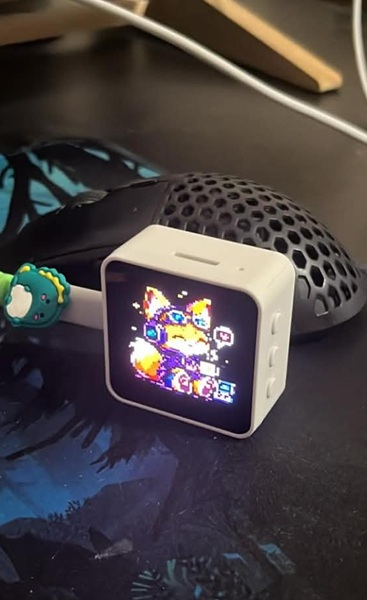
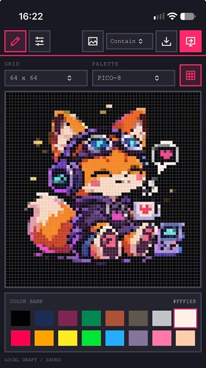

# Project: ESP32-S3 AMOLED Network Image Display

 

## Implemented features ✨

A tiny Wi-Fi display with a pixel-art studio built right in:

- **Make pixel art on the device:** Draw in the built-in web editor with five grid sizes, classic palettes, image import, PNG export, and browser-saved drafts.
- **Set it up from your phone/laptop:** Connect over Wi-Fi AP or STA, configure network credentials, check device status, and send or clear artwork.
- **Display your images your way:** Upload JPEG, PNG, or BMP images and choose contain, cover, or stretch fitting.
- **Follow the device orientation:** The onboard motion sensor detects rotation and keeps the image and on-screen indicators oriented for viewing.
- **Pick up where you left off:** The most recently displayed image is saved across restarts with crash-safe updates.
- **Wake to sound, rest when quiet:** Onboard microphones drive a sound-level indicator and wake the screen after two qualifying sound events; the display fades off after inactivity.
- **Swipe for the brightness you want:** Adjust brightness with a touch gesture, preview it live, and have your preferred awake level saved.

## 1. Project goal

Develop custom firmware for the Waveshare ESP32-S3-Touch-AMOLED-2.16 development board.

The device should function as a network-accessible image display. It should receive images over HTTP and render them on its 480×480 AMOLED display.

The firmware must be modular, maintainable and designed for future extensions (layers, animations, multiple image sources, WebSocket communication, etc.).

Do not implement future features prematurely. The initial goal is a reliable, minimal image display device.

## 2. Hardware

Target board: Waveshare ESP32-S3-Touch-AMOLED-2.16

Verified hardware information:

- MCU: ESP32-S3 (QFN56), revision 0.2
- CPU: Dual Core, 240 MHz
- Flash: 16 MB
- PSRAM: 8 MB (AP_3v3)
- Wi-Fi: 2.4 GHz
- Bluetooth: BLE 5
- Display: 2.16-inch AMOLED, 480×480, 16.7M colors
- USB: Native USB Serial/JTAG
- Power management: AXP2101

### Board research (2026-11-04)

Waveshare's product-specific documentation and first-party repository confirm:

- AMOLED controller: CO5300, 480 × 480, QSPI interface.
- Touch controller: CST9220 capacitive touch.
- Power-management IC: AXP2101.
- Board support component: `waveshare/esp32_s3_touch_amoled_2_16` (official examples declare version `^2.0.1`).
- Waveshare's ESP-IDF guide requires ESP-IDF 5.5 or newer. The first-party example repository reports its example projects tested on ESP-IDF 5.5.5 and 6.0.2; this supports using the project's planned 6.1 release.
- The documented display example calls `bsp_display_start()` from the Waveshare BSP and then runs LVGL. That is evidence for the vendor-supported bring-up path, but it does not establish a non-LVGL panel initialization sequence. This project will keep its no-LVGL requirement and inspect the BSP implementation before selecting the display driver integration.
- The published example uses a BOOT button for IMU recalibration. This does not establish PWR-button signaling. The AXP2101 short-press event path and safe PWR-button behavior remain unverified; do not implement AP toggling until they are confirmed from the schematic and PMU driver/example.

Primary sources:

- [Waveshare product documentation](https://docs.waveshare.com/ESP32-S3-Touch-AMOLED-2.16)
- [Waveshare ESP-IDF guide](https://docs.waveshare.com/ESP32-S3-Touch-AMOLED-2.16/ESP-IDF)
- [Waveshare first-party examples and schematic](https://github.com/waveshareteam/ESP32-S3-Touch-AMOLED-2.16)
- [ESP-IDF 6.1 documentation](https://docs.espressif.com/projects/esp-idf/en/v6.1/esp32s3/)

### Stage 1 hardware verification (2026-11-05)

The product schematic and board-specific BSP/example sources establish:

| Function | Verified configuration |
| --- | --- |
| AMOLED | CO5300, 480 × 480, RGB565, SPI2 QSPI at 40 MHz |
| QSPI signals | CS GPIO12, clock GPIO38, data0–3 GPIO4–7 |
| Display reset | GPIO39 |
| Display supply | Connector J4 uses VCC3V3, supplied by AXP2101 DCDC1; no separate display-power GPIO is required |
| Shared I2C | SDA GPIO15, SCL GPIO14, 400 kHz |
| PMIC | AXP2101 at 7-bit address `0x34`, chip ID `0x4A` in register `0x03` |
| PMIC measurements | Register `0x30`, bits 0/2/3 enable battery/VBUS/system voltage ADCs |
| PSRAM | 8 MB octal, 80 MHz; initialized and memory-tested by ESP-IDF before `app_main` |
| Microphone capture | Dual onboard microphones through ES7210 ADC; I2C address `0x40`, I2S MCLK GPIO42, BCLK GPIO9, LRCK GPIO45, data GPIO10 |
| Touch wiring (not initialized in Stage 1) | I2C as above, reset GPIO40, interrupt GPIO11 |
| USB console | Native USB Serial/JTAG, USB D− GPIO19 and D+ GPIO20 |
| User button | KEY3, GPIO18, external 10 kOhm pull-up to VCC3V3, active-low (pressed connects to GND) |

Stage 1 uses the board-specific CO5300 register sequence from the Waveshare BSP, including its 600 ms sleep-out/display-on delays, 480 × 480 address window, `0x3A=0x55` RGB565 mode and `0x36=0xA0` orientation. These are panel-specific values, not the generic driver's default sequence.

Implementation sources inspected:

- [Waveshare schematic, page 1](https://github.com/waveshareteam/ESP32-S3-Touch-AMOLED-2.16/blob/225a62bff11b5d0a0b607873860d39485a9a9685/schematic/ESP32-S3-Touch-AMOLED-2.16-Schematic.pdf)
- [Board-specific BSP initialization](https://github.com/waveshareteam/Waveshare-ESP32-components/blob/23a6012d5e87d27399cf90fb851cab3689e29159/bsp/esp32_s3_touch_amoled_2_16/esp32_s3_touch_amoled_2_16.c)
- [BSP pin definitions](https://github.com/waveshareteam/Waveshare-ESP32-components/blob/23a6012d5e87d27399cf90fb851cab3689e29159/bsp/esp32_s3_touch_amoled_2_16/include/bsp/esp32_s3_touch_amoled_2_16.h)
- [Official PSRAM defaults](https://github.com/waveshareteam/ESP32-S3-Touch-AMOLED-2.16/blob/225a62bff11b5d0a0b607873860d39485a9a9685/examples/esp-idf/02_lvgl_demo_v9/sdkconfig.defaults)
- [Official PMIC example](https://github.com/waveshareteam/ESP32-S3-Touch-AMOLED-2.16/blob/225a62bff11b5d0a0b607873860d39485a9a9685/examples/esp-idf/01_AXP2101/main/port_axp2101.cpp) and its [register definitions](https://github.com/waveshareteam/ESP32-S3-Touch-AMOLED-2.16/blob/225a62bff11b5d0a0b607873860d39485a9a9685/examples/esp-idf/01_AXP2101/components/XPowersLib/src/REG/AXP2101Constants.h)
- [AXP2101 software datasheet](https://files.waveshare.com/wiki/common/X-power-AXP2101_SWcharge_V1.0.pdf), including the short-press enable and write-one-to-clear IRQ status registers
- [Waveshare GPIO pin assignments](https://docs.waveshare.com/ESP32-S3-Touch-AMOLED-2.16#gpio-pin-assignments), including GPIO18/KEY3 wiring and pressed polarity
- [Waveshare audio pin assignments](https://docs.waveshare.com/ESP32-S3-Touch-AMOLED-2.16#audio-pins), including ES7210 and microphone I2S wiring

The schematic labels an AXP IRQ net but does not establish a normal ESP32 GPIO interrupt connection; the official ESP-IDF PMIC example defaults its interrupt pin to `-1`. PWR-button timing, short-press reporting and safe behavior remain Stage 2 prerequisites. Stage 1 does not register PMIC interrupts or change power-button behavior.

The board currently has factory firmware installed.

A complete 16 MB flash backup has already been created:
`backups/factory-backup.bin`

Its size was verified to be exactly 16,777,216 bytes.

The following security properties were verified through espefuse:

- Secure Boot disabled
- Flash Encryption disabled
- Download mode enabled
- USB Serial/JTAG enabled

**IMPORTANT:** Never erase or modify eFuses. Never enable Secure Boot or Flash Encryption. Do not perform any destructive operation without explicit approval.

## 3. Development environment

- ESP-IDF 6.1
- ESP-IDF tools installed through Espressif Installation Manager
- VS Code with ESP-IDF extension
- Windows development environment
- Firmware language: C/C++ using ESP-IDF
- Embedded web editor: plain JavaScript + CSS, with no frontend build step

Do not use Arduino framework.

Do not introduce Python-based application code. Python utilities bundled with ESP-IDF are acceptable when required by the official toolchain.

Use native ESP-IDF APIs wherever practical.

## 4. First task: hardware research

Before implementing anything, investigate the exact board.

Use the official Waveshare documentation and official example repositories:

https://docs.waveshare.com/ESP32-S3-Touch-AMOLED-2.16

https://github.com/waveshareteam

Identify and document:

- Exact AMOLED controller and initialization sequence
- Display interface and GPIO assignments
- Display driver and supported pixel formats
- Touch controller and GPIO assignments
- AXP2101 power management configuration
- PSRAM initialization and configuration
- Physical button assignments and behavior
- USB and boot configuration
- Any required board-specific initialization sequence

Prefer adapting proven Waveshare examples over implementing hardware initialization from scratch.

Do not guess GPIO assignments, display controller models or button behavior.

## 5. Display subsystem

Implement a display abstraction independent of the network and image decoding layers.

Responsibilities:

- Initialize the AMOLED display.
- Manage framebuffer memory.
- Support RGB565 as the internal rendering format.
- Display images at 480×480.
- Fit images across the full 480×480 area. Stage 8 optionally overlays a 20-pixel-wide noise indicator at x=10–29 (viewer's left; it follows image rotation since Stage 9) without changing image placement.
- Clear the display.
- Handle image updates without unnecessary flickering.

Use the available 8 MB PSRAM for large buffers when appropriate.

Touch swipes select the awake brightness: up increases and down decreases,
clamped to 10%-100%. A 20-pixel tolerance rejects small movements; a qualifying
swipe scales by its full vertical distance, with 480 pixels equal to 100
percentage points. Directions follow image rotation. The panel brightness follows
the finger live during the swipe (no ramp), while a right-side bar shows the level.
The selected level is saved in NVS on release and restored at startup and on every activity
wake; the first-use default is 80%. Existing idle fade-to-0% and panel-off
behavior remains independent of this minimum. The first contact while the
panel is off only wakes it; release before making a brightness swipe.

A full 480×480 RGB565 framebuffer requires 460,800 bytes.

Initial image fitting modes:

- `contain`: preserve aspect ratio, fit entire image, pad unused area.
- `cover`: preserve aspect ratio, crop excess content.
- `stretch`: resize to exactly 480×480.

Do not introduce LVGL unless there is a clear technical reason. Prefer a simple native display implementation initially.

## 6. Wi-Fi subsystem: AP + STA

The device must support simultaneous Wi-Fi Access Point and Station modes.

### Station mode (STA)

- Connect to an existing 2.4 GHz Wi-Fi network.
- Store credentials persistently in NVS.
- Automatically reconnect after connection loss.
- Obtain IP through DHCP.
- Expose the HTTP server through the STA interface.
- Support mDNS, preferably `esp32-display.local`.

### Access Point mode (AP)

- The device must be able to create its own Wi-Fi network.
- Default SSID: `ESP32-Display-XXXX`, where XXXX is derived from the device MAC address.
- Default IP: `192.168.4.1`.
- Use WPA2-PSK.
- Use a configurable, unique password.
- The HTTP server and web interface must be accessible through the AP.
- If STA credentials are already configured, leave the AP off at startup; the PWR button can enable it when needed.

### AP power-button control — IMPORTANT

The physical PWR button must control the AP state.

Required behavior:

- When AP is enabled, a short PWR button press disables the AP.
- When AP is disabled, a short PWR button press enables the AP.
- The STA connection must remain active when the AP is disabled.
- The display must remain operational.
- The HTTP server must remain accessible through STA when available.
- Enabling/disabling AP must not restart the entire device.
- Debounce button events.
- Avoid accidental repeated toggles from a single physical press.

**Hardware research is mandatory before implementing this.**

The PWR button may be connected to the AXP2101 power-management IC rather than directly to a normal GPIO. Investigate the board schematic and official examples to determine how short-press events are reported.

Do not accidentally trigger the AXP2101 hardware power-off behavior.

Do not assume that the BOOT or GPIO18 user button is the PWR button.

If the PWR button cannot safely be used for this purpose because of hardware limitations, explain the limitation and propose an alternative before implementing a workaround.

### Startup behavior

- Start the STA connection process at boot if credentials are configured.
- If STA credentials are configured, start in STA-only mode and leave AP off, regardless of whether the router is reachable.
- If no STA credentials are configured, start AP so that the device remains discoverable and configurable.
- The physical PWR button can enable or disable AP at runtime. When STA credentials are configured, enabling AP uses AP+STA mode and preserves STA operation.
- Avoid blocking the main application while connecting to Wi-Fi.

## 7. HTTP server and REST API

Implement one HTTP server accessible through both AP and STA interfaces.

Initially, REST is sufficient. Do not implement WebSocket yet, but keep the architecture extensible for future WebSocket communication.

Endpoints:

| Method | Endpoint | Description |
|---|---|---|
| GET | `/` | Serve the static web interface |
| GET | `/api/device` | Device information |
| GET | `/api/network` | STA/AP status and IP information |
| POST | `/api/wifi` | Configure STA credentials |
| DELETE | `/api/wifi` | Remove saved STA credentials |
| POST | `/api/image` | Upload and display an image |
| DELETE | `/api/image` | Clear the display |

### Image upload

Use binary HTTP request bodies.

Example:

`POST /api/image?fit=contain`

Supported content types:

- `image/jpeg`
- `image/png`
- `image/bmp`

Validate the content type and actual image signature.

Requirements:

- Enforce a configurable maximum upload size.
- Validate image dimensions before allocating large buffers whenever possible.
- Handle malformed and unsupported images gracefully.
- Return meaningful HTTP status codes and error messages.
- Avoid unnecessary copies of image data.
- Do not store uploaded images permanently unless explicitly requested.

Example successful response:

```json
{
  "success": true,
  "width": 480,
  "height": 480,
  "format": "jpeg",
  "fit": "contain"
}
```

### Network API

`GET /api/network` should return structured information about:

- STA connection state
- STA IP address
- STA RSSI
- AP enabled state
- AP IP address
- AP SSID

Never return Wi-Fi passwords through API responses.

## 8. Image decoding

Implement a separate image decoding subsystem.

Required formats:

1. JPEG
2. PNG
3. BMP

Convert decoded pixels into RGB565 for display.

Investigate suitable ESP-IDF-compatible libraries and decoder implementations before choosing dependencies.

Consider memory usage carefully, especially for PNG decoding.

Avoid allocating the entire compressed image and multiple full-size intermediate buffers unnecessarily.

Keep the decoder interface independent of the HTTP implementation.

## 9. Static web interface

Serve a small static web application directly from the device.

The interface is a retro-styled, mobile-first pixel editor with a compact icon
menu switching between **Editor** and **Setup**. It uses plain CSS and JavaScript
(arrow functions), system monospace fonts, and no framework, CDN, or frontend
build step. This replaces the original deferred separate Bun + TypeScript editor:
the editor now runs directly in the existing embedded static application and
uploads its final rendered image through the unchanged REST API.

Editor behavior:

- Square drawing grids: `8×8`, `16×16`, `32×32` (initial default), `64×64`, and
  `128×128`. Changing resolution resizes the current drawing with nearest-neighbor
  sampling; shrinking can discard detail.
- Draw directly with the selected color; there are no separate Draw, Erase, or
  Clear canvas buttons. Select black in the PICO-8 or NES-inspired palette to
  paint over pixels. The grid overlay toggle sits beside resolution and palette
  selectors; grid lines are never included in exported images. The editor keeps
  a cached pixel buffer and grid layer, updates only changed pixels during a
  stroke, and coalesces pointer events into one render per animation frame; the
  final canvas, downloads, and uploads are unchanged.
- Predefined PICO-8, Game Boy, and NES-inspired color palettes. Changing palettes
  only affects subsequent drawing, not existing pixels.
- Import a local JPEG, PNG, or BMP into the current grid with `contain` (default),
  `cover`, or `stretch`. Original colors are kept, with no palette quantization;
  transparent pixels and contain padding are composited onto black. The canvas
  previews the result before sending. Unsupported or malformed inputs report errors.
- Import requires confirmation because there is no undo.
- Download PNG at the drawing's logical grid resolution. **Send to ESP** uploads
  an opaque `480×480` PNG with binary `image/png` content to
  `POST /api/image?fit=stretch`, with nearest-neighbor scaling and the existing
  1 MiB upload limit. `64×64` and `128×128` do not divide 480 evenly, so their
  scaled pixel blocks can differ by one physical pixel.
- One versioned localStorage draft automatically saves pixels, resolution,
  palette, selected color, and grid visibility. Reload restores the drawing;
  storage failures are reported and PNG download remains available. Storage is
  browser- and origin-specific: the device's AP IP, STA IP, and mDNS hostname
  each have separate drafts, and clearing browser data removes them.
- Wi-Fi credentials are never saved in localStorage. Drawing and download remain
  usable without a reachable device; sending and setup require the device API.

Setup retains device/network status and current IP addresses, manual and periodic
status refresh, Wi-Fi SSID/password configuration, and **Clear device**. Clearing
the device does not clear the local drawing.

The left-aligned view menu and a single row of Import/Fit/PNG/Send actions occupy
the header. These actions are visible only in Editor; compact screens use labeled
icon buttons with accessible names and tooltips instead of visible action text.
Portrait prioritizes a full-width square drawing area with minimal margins;
landscape places selectors and colors beside the canvas to maximize its height,
with palette colors filling two columns top-to-bottom.
Square viewports use the side-panel layout and fit the canvas to the smaller
available dimension. Short portrait viewports may need editor-panel scrolling
to preserve the full-width canvas; the document itself does not scroll.
Constrained panel scrolling also keeps controls reachable with enlarged text
or the virtual keyboard. At `128×128`, individual cells are small on phones. Zoom/pan, undo/redo,
fill, eyedropper, shapes, layers, animation, and a multi-drawing gallery are
intentionally outside this editor's scope.

App text and canvas long-press selection/context menus are disabled; Wi-Fi text
fields still support selection and editing. Touch gestures permit panel scrolling
but disable pinch and double-tap zoom, with viewport restrictions and an app
gesture guard for Safari. Browsers may override zoom restrictions for accessibility;
desktop browser zoom shortcuts are not intercepted.

Editor software validation: JavaScript syntax checks and session-local
Playwright/Edge checks pass with the firmware CSP and mocked same-origin APIs.
Coverage includes all five PNG grid sizes, exact `480×480` uploads, touch/pen
strokes, orientation changes, import fitting and transparency, draft recovery
and storage failures, and API errors/offline drawing. The compact layout is
checked for full-width portrait and height-filling landscape canvases,
single-row header actions, square viewports, and preserved draft/export behavior.
Additional browser checks cover top-to-bottom landscape palettes, suppressed
selection/context menus, editable Wi-Fi fields, gesture cancellation, and an
emulated two-finger pinch retaining viewport scale 1.
The ESP-IDF 6.1 build passes with the embedded editor (54% of the app partition
free). No firmware was flashed; physical-device rendering remains to be tested.

Do not couple the firmware to a particular frontend framework.

Keep the editable static frontend in the project-level `web/` directory. Embed `web/index.html`, `web/style.css`, and `web/script.js` into the firmware at build time and serve them as same-origin resources; do not allocate a filesystem partition for these assets. Editing the source files requires rebuilding and flashing the firmware.

See the ESP-IDF v6.1 [Embedding Binary Data](https://docs.espressif.com/projects/esp-idf/en/v6.1/esp32s3/api-guides/build-system.html#embedding-binary-data) documentation for details on embedding files.

The HTTP response for the page should use a restrictive Content Security Policy that blocks inline scripts and styles while allowing same-origin assets and API requests. The local image preview uses a `blob:` URL, so allow that scheme for images only.

## 10. Architecture and project structure

Use clear separation of responsibilities.

Suggested structure:

```text
├── CMakeLists.txt
├── sdkconfig.defaults
├── partitions.csv
├── main/
│   ├── CMakeLists.txt
│   ├── app_main.cpp
│   ├── system/
│   │   ├── config.cpp
│   │   └── storage.cpp
│   ├── network/
│   │   ├── wifi_manager.cpp
│   │   ├── http_server.cpp
│   │   └── mdns.cpp
│   ├── api/
│   │   ├── device_api.cpp
│   │   ├── network_api.cpp
│   │   ├── wifi_api.cpp
│   │   └── image_api.cpp
│   ├── display/
│   │   ├── display_driver.cpp
│   │   └── framebuffer.cpp
│   ├── image/
│   │   ├── image_decoder.cpp
│   │   ├── jpeg_decoder.cpp
│   │   ├── png_decoder.cpp
│   │   └── bmp_decoder.cpp
│   └── input/
│       └── power_button.cpp
├── web/
│   ├── index.html
│   ├── style.css
│   └── script.js
└── README.md
```

This is a suggested structure, not a requirement to create empty files for every module immediately.

Use C++ where it improves encapsulation, but prefer straightforward ESP-IDF-compatible code over unnecessary abstraction.

## 11. Future extensions — do not implement yet

The architecture should allow future support for:

- Multiple image layers
- Layer ordering and positioning
- Alpha blending
- Animated images
- WebSocket communication
- Real-time display updates
- A separate web-based image editor
- Multiple image sources
- External automation and MES integration

Do not implement any of these in the initial version.

## 12. Development workflow

Work incrementally.

### Stage 1–4 implementation

The project implements board initialization (Stage 1), user-button brightness control (Stage 1A), PWR-button AP control (Stage 2), AP + STA networking (Stage 3), the Stage 4 web/status/clear interface, JPEG/PNG/BMP decode and render with QMI8658 orientation (Stage 5), persistent image storage and timed brightness (Stage 6), and the Stage 7 microphone noise-level indicator. Touch is not implemented.

- `main/system/board_config.h` isolates verified board pins and memory/display sizes.
- `main/system/power_management.cpp` uses native ESP-IDF I2C to verify the AXP2101 and enable voltage ADCs with read-modify-write and readback. Existing regulator voltages/enables, charger/temperature-sensor settings, interrupts and PWR-key behavior are deliberately preserved. The official display example likewise does not reprogram the display supply. This is not a battery-charging policy or power-control implementation.
- `app_main` requires initialized PSRAM with exactly 8,388,608 detected bytes. ESP-IDF's boot memory test is enabled and missing PSRAM is fatal rather than silently falling back to internal RAM.
- `main/display/display_driver.cpp` uses the managed `espressif/esp_lcd_co5300` **2.2.0** component with the verified Waveshare panel sequence. The full BSP is not linked because it unconditionally depends on LVGL and unrelated audio/touch/USB components. `dependencies.lock` records the resolved driver and build-helper versions.
- A 460,800-byte native-order RGB565 framebuffer is allocated in PSRAM. A single 19,200-byte internal DMA staging buffer sends 20-row stripes in panel-required big-endian pixel order; this also holds the full 20×480-pixel indicator update. Each transfer waits for its completion callback with a bounded timeout before reusing the buffer. Buffers remain allocated for the application's lifetime; allocation, bus, panel and transfer failures are logged and fatal during bring-up.
- The panel is blanked while uploading the pattern, then enabled at 20% brightness. The pattern contains white/yellow/cyan/green/magenta/red/blue/black bars, a white center cross and a lower grayscale ramp. Its square-frame corners are naturally clipped by the circular visible display. Initialization delays and transfer waits occur only during startup; there is no polling or busy main loop. Stage 1 does not yet provide continuous updates or tearing synchronization.

The custom partition table in `partitions.csv` keeps NVS at `0x9000` (24 KB) and PHY data at `0xf000` (4 KB), allocates a 2.5 MiB factory application at `0x10000`, and reserves two 1.0625 MiB data slots for crash-safe last-image updates. OTA and a general filesystem remain unallocated. Updating firmware with this partition table changes the on-flash layout; it must be flashed without a full-chip erase, and the existing factory backup must remain untouched.

### Stage 1A implementation: manual brightness (historical; replaced by Stage 8)

The original Stage 1A GPIO18 behavior (KEY3, not BOOT or PWR) changed brightness once per debounced press:

```text
20 -> 10 -> 0 -> 100 -> 90 -> 80 -> 70 -> 60 -> 50 -> 40 -> 30 -> 20 -> ...
```

- Historically, brightness was a percentage from 0 to 100, initially 20 after every reboot, and was not persisted. Stage 8 replaced the cycle; Stage 9 adds persistent touch-selected awake brightness.
- `main/input/brightness_button.cpp` configures the verified active-low GPIO as an input and samples it every 10 ms in a dedicated FreeRTOS task. Press and release each require 50 ms of stable input. Holding the button does not repeat. A button held when the task starts must first be released before it can trigger a step.
- `main/input/button_debouncer.h` isolates the debounce state machine. Brightness changes occur in task context, not an ISR, and `app_main` returns normally. The existing FreeRTOS 100 Hz tick rate needs no configuration changes.
- `display::decrease_brightness()` is the single owner of brightness state; it sends the CO5300 brightness command and updates the tracked value only on success. Failures are logged; release and press again to retry. There are no other runtime display writers at this stage; future network/display work must serialize access before introducing concurrent writers.
- 0% sets the brightness register to zero without powering off the board or discarding the image. The next press wraps directly to 100%, as requested. This is not panel sleep, an idle timeout or automatic burn-in protection; avoid prolonged static content at high brightness.
- PWR remains reserved for Stage 2 AP control. No PMIC power-button, charging or regulator behavior is changed.
- Stage 8 has replaced this cycle: GPIO18 toggles sound-bar visibility and counts as activity, waking the display and restarting its idle timer.

### Stage 2 implementation: AXP2101 PWR button

- On this board the physical PWR switch connects to the AXP2101, not an ESP32 GPIO. The AXP2101 IRQ output is not wired to a usable ESP32 input, so firmware polls the PMIC's latched status over the existing I²C bus.
- `main/system/power_management.cpp` enables only the AXP2101 POWERON short-press IRQ (register `0x41`, bit 3) with read-modify-write. A dedicated task checks IRQ status register `0x49` every 25 ms and writes one to bit 3 to clear only that event. Other pending PMIC status bits are left untouched.
- A short press toggles the AP without restarting the device. With STA credentials configured, disabling AP switches Wi-Fi to STA mode; without credentials, Wi-Fi enters null mode. Re-enabling AP restores AP or AP+STA mode. Display and application tasks are not restarted.
- The driver does not change long-press thresholds, power-off configuration, PMIC rails, or charging settings. The AXP2101 retains its existing long-press power behavior. Physical short-press and long-press interaction still requires board validation.

### Stage 3 implementation: AP + STA and network setup API

- `main/network/network_manager.cpp` initializes STA-only mode when STA credentials are available, otherwise AP mode. It does not wait for a connection before deciding whether to start AP. The PWR button can enable AP later, switching to AP+STA while preserving STA. The default SSID is `ESP32-Display-XXXX`, derived from the SoftAP MAC, with WPA2-PSK and the default AP address `192.168.4.1`.
- Wi-Fi startup selects AP or AP+STA mode before applying interface-specific configurations. Runtime mode changes use the same ordering so ESP-IDF has the AP/STA interface enabled before `esp_wifi_set_config()` is called.
- The default AP password is derived from the full factory Wi-Fi MAC and saved in NVS. It is printed in the USB serial boot log for initial setup. `APP_AP_PASSWORD` in project configuration can supply a custom initial password; `POST /api/ap/password` changes and persists it. The AP password is never included in API responses.
- `APP_STA_SSID` and `APP_STA_PASSWORD` can seed initial station credentials through `menuconfig`; the firmware stores them in NVS on first boot. `POST /api/wifi` and `DELETE /api/wifi` set or remove credentials at runtime. STA reconnect attempts use a five-second retry timer, and a missing STA network does not stop AP operation.
- `APP_HOSTNAME` in `menuconfig` configures the station DHCP hostname and mDNS hostname (default `esp32-display`), so the router-visible name and `<hostname>.local` address match. Use 1-32 ASCII letters, digits, or hyphens, with a letter or digit at each end; do not include `.local`. This setting does not change the SoftAP SSID. As with other Kconfig options, defaults populate fresh configurations; for an existing `sdkconfig`, set the value in `menuconfig` or add/update its `CONFIG_APP_HOSTNAME` entry.
- mDNS advertises `<hostname>.local` and the HTTP service. The HTTP server is reachable through AP and STA. Implemented routes include `GET /`, `GET /api/device`, `GET /api/network`, `POST /api/wifi`, `DELETE /api/wifi`, `POST /api/ap/password`, and `POST/DELETE /api/image`.
- Credential and AP-password changes use the documented HTTP API over the local AP or LAN. Use a trusted network; the initial API is HTTP and does not provide TLS or user accounts. The setup password is available in the USB serial boot log.

### Stage 4 implementation: HTTP interface

- `GET /` serves the embedded `web/index.html`; `GET /style.css` and `GET /script.js` serve its separately embedded styles and behavior. The page has a restrictive Content Security Policy with no inline scripts or styles. These resources are compiled into firmware; no filesystem partition or frontend framework is required.
- `DELETE /api/image` clears the RGB565 framebuffer and transfers the black frame to the display. Display writes and brightness commands share a mutex so HTTP requests cannot overlap the button task's panel operations.
- The HTTP service registers the image upload and clear routes in addition to the Stage 3 routes. The existing HTTP/no-authentication security limitation remains: configure credentials only on a trusted local network.

### Stage 5 implementation: JPEG decode and display fitting

- `main/image/jpeg_decoder.cpp` uses Espressif's `esp_jpeg` component. It inspects JPEG dimensions before allocating decoded output and selects the largest decoder scale that keeps the result at or below 480 × 480. The compressed request and decoded RGB565 pixels use PSRAM; decoded memory is capped at one display frame.
- `display::show_rgb565()` serializes against brightness and clear operations, applies `contain`, `cover`, or `stretch` using nearest-neighbor sampling across the full 480×480 image area, flushes the frame, then requests activity from the display-control task. The Stage 8 indicator is an optional overlay, not reserved image space.
- The display retains a PSRAM copy of the latest decoded image so orientation changes can redraw it without another upload. `clear()` releases that copy.
- `POST /api/image` decodes JPEG, PNG, and BMP and returns width, height, format, and fit on success. PNG and BMP inputs are limited to 480 × 480 pixels to bound decoder memory. PNG transparency is composited onto black. BMP support is limited to uncompressed 24-bit and 32-bit files; palette, bitfield-compressed, and other encodings are rejected. Progressive JPEG support follows the limits of the bundled decoder and may be rejected as malformed. Stage 6 stores the successfully decoded upload's original compressed bytes in flash for restart recovery.
- `main/input/orientation.cpp` initializes the QMI8658 at address `0x6B` on the PMIC module's existing 400 kHz GPIO14/15 I²C bus. It samples accelerometer data every 100 ms and accepts a new orientation after eight consecutive samples with at least 0.70 g on a dominant in-plane axis. Face-up/down and diagonal positions retain the last orientation, providing hysteresis against boundary flicker. The accelerometer runs at 125 Hz in ±4 g range; the gyroscope is left disabled. The managed driver 2.0.2 header declares `qmi8658_read_accel_mps2()`, but that version does not define it, so the firmware uses the implemented `qmi8658_read_accel()` with m/s² units enabled.
- Orientation is applied in software before fitting, so all three fit modes rotate with the display while panel initialization stays fixed. The mapping assumes the sensor X/Y axes lie in the display plane: +Y is 0°, −X is 90°, −Y is 180°, and +X is 270°. Confirm the physical mapping and stability on the board; sensor-axis mounting and orientation cannot be confirmed by a host build.

The Stage 1A 11-step brightness-cycle assertions were removed with that cycle in Stage 8. `tests\activity_state_test.cpp` covers brightness ramps, `0x51` raw values, idle deadlines, activity sources, and retargeting after touch adjustments; `tests\touch_gesture_test.cpp` covers raw reports, rotation-aware gestures, cancellation, and brightness bounds. `tests\sound_events_test.cpp` covers sound qualification, re-arm, event windows, baseline protection, and configuration validity. The standalone compile-time debounce tests cover the exact debounce threshold, bounce on press/release, short presses, holding, repeated presses, a startup-held button and tick-counter wraparound:

```powershell
# After loading the ESP-IDF profile:
xtensa-esp32s3-elf-g++.exe -std=c++17 -fsyntax-only -Wall -Wextra -Werror -I main tests\button_debouncer_test.cpp tests\activity_state_test.cpp tests\sound_events_test.cpp tests\touch_gesture_test.cpp tests\live_brightness_test.cpp tests\overlay_geometry_test.cpp tests\render_mapping_test.cpp tests\crc32_test.cpp
if ($LASTEXITCODE -ne 0) { throw "Logic regression tests failed" }
python "$env:IDF_PATH\tools\idf.py" build
if ($LASTEXITCODE -ne 0) { throw "Firmware build failed" }
```

### Build and board acceptance

The ESP-IDF 6.1 framework and tools are available after loading the Installation Manager profile:

```powershell
. C:\Espressif\tools\Microsoft.v6.1.PowerShell_profile.ps1
idf.py build
```

VS Code uses the ESP-IDF extension, the workspace-root `build` directory and `sdkconfig.defaults`; competing CMake Tools auto-configuration stays disabled. `idf.flashType` remains `UART`: this extension label selects esptool's serial transport, including the board's native USB Serial/JTAG COM port, not an external UART requirement. COM4 is the current port; update it if Windows assigns another port. The firmware console uses USB Serial/JTAG, and the monitor is configured for 115200.

Generated `build/` and `sdkconfig` are ignored. Defaults apply when `sdkconfig` is first generated; an existing configuration can override them. For a scaffold configuration without PSRAM/USB-console settings, preserve a copy of `sdkconfig`, remove the generated original, then reconfigure/build to apply Stage 1 defaults. Do not discard intentional menuconfig changes without reviewing them. After relocating a project or build directory, use **ESP-IDF: Full Clean Project** before rebuilding: generated CMake response files contain absolute paths.

No firmware flash is authorized by implementation or build alone. The factory backup at `backups/factory-backup.bin` must remain untouched, and flashing requires explicit approval.

After approval, hardware acceptance consists of:

1. Flash through the native USB Serial/JTAG COM port using ESP-IDF's serial/esptool transport, without a full-chip erase or eFuse operations.
2. Monitor boot and confirm the PSRAM memory test passes and `PSRAM detected: 8388608 bytes` is logged.
3. Confirm AXP2101 identification/ADC readback and CO5300 initialization succeed without resets or DMA timeout errors.
4. Confirm the visible test pattern has correct colors, a centered cross and smooth black-to-white grayscale, at reduced brightness.
5. Reboot and repeat. Avoid leaving a static AMOLED test pattern on for extended periods.

A successful build verifies compilation and configuration, not physical panel operation or PWR-button safety. The user reports that board acceptance for Stages 1A–5 passed. Stage 6 persistence and timed brightness still need physical validation after the updated firmware is flashed.

Software validation (2026-11-05): the ESP-IDF 6.1 ESP32-S3 build and Stage 1A compile-time logic tests pass. The firmware image with brightness-button control is 255,184 bytes, leaving 76% of the temporary 1 MB app partition free. Generated configuration checks confirm octal PSRAM at 80 MHz with boot memory test, 240 MHz CPU, USB Serial/JTAG console, 16 MB flash, no LVGL dependency and no Secure Boot/Flash Encryption enablement. ESP-IDF 6.1 may emit component-validation warnings for private `esp_wifi`/`wpa_supplicant` include directories (`wifi_apps/roaming_app` and `esp_supplicant`). These paths are declared by the framework's own component CMake files and are used internally by those components; they are not project include paths or firmware warnings. A warning-free configure requires an ESP-IDF release containing the corresponding framework CMake correction; changing application `PRIV_REQUIRES` cannot correct these internal declarations.

Stage 2–3 software validation (2026-11-05): the ESP-IDF 6.1 ESP32-S3 build passes after correcting Wi-Fi initialization ordering and skipping AP configuration in STA-only mode. The startup mode is selected before applying configurations for enabled interfaces, avoiding `ESP_ERR_WIFI_MODE` during SoftAP setup. With configured STA credentials, startup is STA-only and does not depend on connection success. The firmware binary is 964,048 bytes; the current 1 MiB app partition has 84,528 bytes (about 8%) free. Physical network and PWR-button acceptance remains pending after an approved flash.

Stage 4 software validation (2026-11-05): the ESP-IDF 6.1 ESP32-S3 build passes with the embedded web page and image clear/upload routes. The firmware binary is 968,272 bytes; 80,304 bytes (about 8%) remain in the temporary 1 MiB app partition. VS Code reports no diagnostics in the modified display and API sources. Image upload intentionally returns HTTP 501 after type/signature validation until Stage 5 adds decoding. AP/STA browser access and physical display clearing remain pending hardware acceptance.

Stage 5 software validation: the ESP-IDF 6.1 ESP32-S3 build passes with JPEG, PNG, and BMP decoding, bounded PSRAM buffers, RGB565 fitting, and QMI8658 orientation/redraw support. The firmware binary is 0x103700 bytes; the 0x177000 app partition leaves 0x73900 bytes (31%) free. Physical sensor-axis, PNG/BMP decode, upload, and render validation remain pending an approved flash.

The user reports that Stage 1A physical acceptance passed: the GPIO18 brightness cycle, hold behavior, reboot default, image retention at 0%, and separation from BOOT/PWR were verified on the board.

The user reports that Stage 2–3 physical acceptance passed: PWR short/long press behavior, AP toggling, STA connection and DHCP, reconnect, credential persistence, HTTP availability, and mDNS were verified on the board.

The user reports that Stage 4–5 hardware testing also passed, including display clearing, image upload/decode/render, and orientation behavior. The new Stage 6 persistence and timed-brightness behavior still requires board validation after firmware installation.

Before coding:

1. Inspect the existing workspace.
2. Inspect the ESP-IDF installation and VS Code configuration.
3. Research the exact Waveshare board.
4. Identify and document all hardware-specific dependencies.
5. Propose the initial project structure and partition layout.
6. Identify any potential hardware or memory constraints.

Then implement in small, independently testable stages:

### Stage 1 — Board initialization

- Create the ESP-IDF project.
- Initialize power management.
- Initialize PSRAM.
- Initialize the AMOLED display.
- Display a simple test pattern or text.

### Stage 1A — User-button brightness

- Verify GPIO18 user-button wiring and pressed polarity.
- Decrease brightness by 10 percentage points per debounced press, wrapping 0 to 100.
- Preserve the 20% startup default; do not repeat while held.
- Keep PWR dedicated to the planned AP toggle.
- Build/test the cycle and debounce logic, then verify on hardware after flash approval.

### Stage 2 — Physical input (implemented; physical acceptance pending)

- Identify the PWR button event.
- Implement safe AP toggle behavior.
- Verify that the display and STA connection remain operational.

### Stage 3 — Networking (implemented; physical acceptance pending)

- Implement AP + STA.
- Persist Wi-Fi credentials.
- Implement reconnect behavior.
- Implement mDNS.

### Stage 4 — HTTP server

- Implemented: serve a minimal embedded page, clear the display, and validate bounded image upload requests and their signatures. Image uploads return HTTP 501 until Stage 5 supplies decoding and rendering.
- Hardware acceptance: test access through both AP and STA.

### Stage 5 — Image display

- Implemented: JPEG decoding and `contain`, `cover`, and `stretch` fitting.
- Implemented: PNG decoding with transparent pixels composited onto black, and uncompressed 24/32-bit BMP decoding. PNG and BMP dimensions are limited to 480 × 480; BMP palettes and compression modes are not supported.
- Implemented: automatic image rotation using the onboard QMI8658 over the shared I²C bus, with stable accelerometer classification and hysteresis. Confirm the assumed sensor-to-display axis mapping on hardware.
- Validate malformed images and memory limits on the board after approved firmware installation.

### Stage 6 — Integration and documentation

- Verify the complete workflow.
- Document build, flash and recovery procedures.
- Document API endpoints and example curl commands.

### Stage 7 — Noise-level indicator

- Capture a short-window RMS sound level from the onboard ES7210 microphones.
- Compare it to a slowly adapting ambient-noise baseline and show the relative level in a 20-pixel-wide vertical strip reserved at the left edge of the display.
- Keep this stage informational only: do not change display brightness or trigger other device actions when the threshold is crossed.
- Verify microphone capture, level response, threshold marker, image fitting, and display rotations on the board.

### Stage 8 — Sound-triggered presence and display power (implemented; board validation pending)

Stage 7 remains the sound-level measurement and indicator foundation. Stage 8 adds presence-like sound activity behavior, automatic display visibility, configurable timings, and repurposes the GPIO18 user key. Sound is only a proxy for nearby activity: loud background sounds can wake the display, and a quiet person may not. Do not describe it as reliable person detection.

- On a successful new image upload, turn the panel on, smoothly ramp brightness to 80% over 800 ms, and start/restart the 30-second activity timer.
- Continue microphone measurement while the display is idle or off. Two distinct qualifying sound events within a 10-second window count as activity; wake the panel, smoothly ramp to 80% over 800 ms, and restart the 30-second timer.
- Define one event as the measured level reaching at least the configured wake threshold continuously for 100 ms (five 20 ms measurement windows). It cannot count again until the level stays below the configured re-arm threshold for 250 ms (about 13 windows). A sustained sound is one event; speech or music with longer pauses can still count twice.
- If no activity occurs during the 30-second timer, smoothly ramp brightness to 0% over 800 ms, then turn the display panel off. Establish 0% before switching an idle panel on and ramping brightness back up.
- Keep the sound bar hidden after boot. A debounced GPIO18 user-key press toggles the bar and counts as activity. Stable orientation changes and successful image clear also count as activity; all wake the panel, ramp to the active brightness, and restart the idle timer. This intentionally extends the original Stage 8 rule that the key only toggled the bar. Microphone measurement continues while the bar is hidden or panel off.
- Overlay the 20-pixel-wide bar at horizontal pixel coordinates x=10 through x=29, leaving 10 pixels between the left edge and the bar. Keep the image fitted to the full 480×480 display underneath. When the bar is hidden, show the unobstructed image in that area; toggling visibility does not change image placement.
- Color the bar green below the configured wake threshold and red at or above it. Use the same wake-threshold setting for event detection and the green/red color split; remove the current fixed +12 dB yellow marker in Stage 8.
- ESP-IDF `menuconfig` options in `main/Kconfig.projbuild` configure active brightness (default 80%), idle timeout (30 seconds), brightness ramp duration (800 ms), wake threshold (default 50%), event qualification duration (100 ms), re-arm threshold (default 30%), re-arm duration (250 ms), required events (2), and event window (10 seconds). These are build-time settings, not runtime controls. Kconfig defaults apply only to options missing from the generated `sdkconfig`; the current local `sdkconfig` has been updated to these values, and an older generated `sdkconfig` must be updated explicitly (menuconfig or editing its `CONFIG_APP_*` lines).
- Keep detection distinct from visual updates and prevent the ambient baseline from absorbing an ongoing event. Threshold percentages are relative to the 0–30 dB scale, not calibrated sound pressure: 50% wake is +15 dB (~5.6× ambient RMS), and 30% re-arm is +9 dB (~2.8×). These replace the earlier 80/60 and 60/40 trials by user request, keeping 6 dB hysteresis and the two-event requirement, and still require physical sensitivity/false-positive testing. Tune them with the INFO qualified/rejected/re-arm `noise-level` messages recorded during intended sounds and ordinary background noise.
- Validate the event counter with quiet, sustained, intermittent, and background-noise cases; verify hidden/visible bar behavior, uploads while the panel is off, smooth brightness transitions, image fitting, and microphone monitoring while the panel is off. Physical validation is required to tune thresholds and confirm panel power behavior.

### Stage 6 implementation — persistent last image and timed brightness (timing superseded by Stage 8)

- `partitions.csv` provides two alternating raw flash slots, each large enough for the maximum 1 MiB compressed upload plus metadata. The slots are separate from NVS and the application partition.
- `main/image/image_store.cpp` stores the original compressed JPEG/PNG/BMP bytes, selected fit mode, generation, and CRC32. Each update is written to the inactive slot and commits its header last, so a power loss during an upload leaves the previous image recoverable. To reduce upload latency and flash wear, an update erases only the header sector plus the sectors occupied by the new payload; a clear marker erases one header sector. Every update erases the header before writing the payload and commits the magic last, preserving the interrupted-write recovery rule. Bytes beyond the new record remain stale in flash but are never read by the API; secure erasure of old image data would require the previous full-slot erase. `DELETE /api/image` writes a clear marker so the old slot is not restored after reboot.
- At startup, the firmware validates the newest saved record, decodes it, and renders it at the selected startup brightness (historically 20%; Stage 9 restores the saved touch level, defaulting to 80%). If there is no saved image or the saved data is invalid, it displays the existing test pattern.
- Historically, uploads displayed at 100% for 30 seconds before returning to 20%, and GPIO18 resumed manual brightness control. Stage 8 replaces this with activity-controlled 80% brightness and fade-to-off.
- Clearing still commits a persistent clear marker. In Stage 8 it also wakes the display and restarts the activity timer instead of setting 20%.
- Flashing the firmware with the custom partition table is required for this feature. Do not use a full-chip erase; preserve the factory backup. The new storage behavior and recovery after interrupted writes require board testing.

Stage 6 software validation (2026-11-05): ESP-IDF 6.1 build passes with the custom partition table and persistent-image/timed-brightness code. The firmware binary is 0x104430 bytes, leaving 0x17bbd0 bytes (59%) of the 2.5 MiB factory app partition free. No firmware was flashed during implementation. Board validation of reboot recovery, `/api/image` deletion persistence, interrupted writes, and the 30-second brightness cycle remains pending.

### Stage 7 implementation — microphone noise-level indicator (updated by Stage 8)

- `main/input/noise_level.cpp` captures both onboard microphones through the ES7210 ADC using ESP-IDF I2S and Espressif's `esp_codec_dev` **1.5.8** component. It reuses the shared I2C bus created by power management; capture clocks and data use GPIO42 (MCLK), GPIO9 (BCLK), GPIO45 (LRCK), and GPIO10 (data in).
- Each complete 20 ms capture window produces an RMS level relative to a slowly adapting ambient baseline. The bar maps 0–30 dB above baseline to 0–100%. The original yellow +12 dB marker was removed in Stage 8; the bar is green below the wake threshold and red at/above it. Baseline adaptation is frozen during qualification and after a qualified event until below-threshold re-arm, for at most 5 seconds (`kMaxBaselineHoldMs`), so sustained sound cannot create repeated events by redefining its own reference. The cap prevents a deadlock observed on the board: a baseline initialized from an all-zero start-up window (1e-6) kept ordinary room noise at 100%, which blocked re-arm, which kept the baseline frozen. All-zero PCM windows are now ignored by the baseline, which initializes from the first non-zero window and never falls below one 16-bit LSB RMS (1/32768). Outside protected events, ordinary levels adapt slowly; levels over 3× baseline require 2 seconds before upward adaptation. This is not calibrated dB SPL.
- Stage 7 originally reserved the leftmost 20 pixels for the bar. Stage 8 overlays the bar at x=10–29 while fitting the image across the full 480×480 display; the bar is hidden at boot and can be toggled with GPIO18.
- Microphone capture and the adaptive baseline require physical validation on the board; the host build cannot confirm codec wiring, gain, sample quality, or useful threshold sensitivity.

Stage 7 software validation (2026-11-05): ESP-IDF 6.1 ESP32-S3 build passed with ES7210 capture support and the original 10-pixel indicator strip. Stage 8 changes the indicator rendering and adds sound-triggered behavior; the new build result is recorded below. Physical microphone capture and indicator behavior remain pending board validation. No firmware was flashed.

### Stage 8 implementation — sound activity, idle panel, and indicator visibility

- The sound monitor maps the relative RMS level to the existing 0–100 indicator scale. A candidate event must remain at or above the configurable wake threshold for the configured qualification period. Once qualified, it cannot count again until the level remains below the re-arm threshold for its configured duration. The default is two events within 10 seconds.
- Two qualified events, a successful image upload/clear, a stable orientation change, or a GPIO18 bar toggle restart the activity timer and request the active brightness. One persistent display-control task owns runtime panel on/off, idle deadlines, and ramp progression; raw redraws never independently power it on. The task runs even if microphone capture fails. Startup/restore was initially 20%; Stage 9 uses the persisted selected level at startup and on all wakes, and adds touch activity.
- Ramps interpolate with signed arithmetic and monotonic elapsed time. Activity interrupts fade-out from the last successfully applied value; activity during fade-in only renews the deadline without restarting/starving the ramp. An idle panel starts at 0% before on, and off is commanded only after a successful 0% write. Queue/command errors are logged explicitly; a failed transition stops and the next activity retries rather than falsely reporting completion.
- ES7210 setup enables initialized RX before codec open, matching the codec's disable/reconfigure/enable sequence and avoiding the initial unenabled-channel error. A complete I2S window is read successfully before capture is declared ready. The codec's record-only "No paired data" INFO message is normal; it refers to absent playback, not missing microphones.
- Capture uses checked native I2S reads, including exact byte counts. Read errors, queue overflow, and excessive processing gaps reset qualification/re-arm continuity. Durations count observed 20 ms audio windows (100 ms is exactly five windows); they never count missing wall time as observed sound. Event timestamps use a rolling window, including event counts above two. Invalid threshold ordering or infeasible event timings fail at compile time.
- Indicator measurements are posted through a one-item overwrite queue. The display task renders the latest value without making capture wait on panel transfers. Indicator state and visibility changes are synchronized with the existing display mutex.
- This stage supersedes Stage 6's fixed 100%-for-30-seconds upload brightness and GPIO18 manual brightness cycle. The default active brightness is 80%, with a configurable 30-second idle timeout. Stage 9 makes the active level touch-adjustable and persistent without changing idle-off behavior.
- GPIO18 toggles indicator visibility and requests activity wake. The indicator starts hidden, overlays x=10–29 and y=10–469 (10-pixel margins at the top and bottom), and uses green below the wake threshold and red at or above it. Hiding the bar redraws its full column from the image framebuffer to remove all bar pixels. Image fitting remains full-screen and unchanged when visibility toggles.
- `main/Kconfig.projbuild` exposes active brightness, idle timeout, ramp duration, wake threshold, qualification duration, re-arm threshold/duration, required event count, and event window as build-time options.
- Redundant brightness writes are skipped. The CO5300 SPI driver's per-step INFO messages are filtered to WARN, and the ESP-IDF `spi_master` tag is capped at INFO because it logs one DEBUG line per bus lock/release; with the sound bar redrawn every 20 ms that flood exceeds the 115200-baud console. Application INFO logs report activity reason/deadline, ramp request/cancellation/completion/failure, commanded panel state, and applied brightness percent/raw value. DEBUG logs report every changed ramp value. Qualified events, rejected candidates (sound that reached the wake threshold but dropped below it before the qualification time), partial-window expiration, re-arm, baseline initialization, baseline-hold expiry, and capture-health changes are visible at INFO/WARN/ERROR. The former once-per-second DEBUG RMS/baseline line was removed by user request.
- Brightness uses CO5300 command `0x51`, not an application PWM pin: raw = floor(percent × 255 / 100), so 0%=0x00, 20%=0x33, 80%=0xCC, and 100%=0xFF. "Applied" and panel state mean the driver command succeeded, not register readback or measured luminance. Physical verification is still required.
- For per-step brightness diagnostics, enable DEBUG logging in menuconfig under Component config → Log output, rebuild, and inspect tag `display`. The local configuration uses INFO, which is sufficient for transition endpoints and sound events. `sdkconfig.defaults` retains DEBUG as a maximum compile level without increasing the default output level on fresh configurations.
- INFO logs record HTTP method/path, SoftAP client joins, GPIO18 user-key debounced press/release edges, and display wake/sleep transitions with their reason. The AXP2101 reports PWR short-press events, not separate down/up edges; BOOT is tied to GPIO0/CHIP_PU reset behavior and is not polled as a runtime key.
- Sound remains a proxy for nearby activity, not reliable person detection. The relative indicator scale is not calibrated sound pressure. No audio is stored or transmitted.

Stage 8 software validation (2026-11-05): ESP-IDF 6.1 ESP32-S3 build passes after sizing the internal DMA staging buffer to 19,200 bytes for the 20-row image stripe and full-height indicator update. After the bar margin, hide-redraw, brightness, and diagnostic logging changes, the firmware image is 0x111b10 bytes (57% of the 2.5 MiB app partition remains free). No firmware was flashed. Physical testing of event classification, bar controls, panel power, and activity timeout remains pending.

Stage 8 repair findings: unsigned interpolation drove downward fades to 100%; a stale timestamp subtraction scheduled sleep immediately after sound wake; orientation/clear independently turned the panel back on without renewing the idle timer; per-request ramp tasks and unsynchronized activity state allowed races; baseline updates/read gaps undermined continuous-event timing; event expiration and applied brightness were not logged; codec setup disabled an RX channel that had never been enabled. The supplied log already contained `2/2`; isolated `1/2` entries more than 10 seconds apart correctly expired but lacked reset diagnostics. Regression tests cover every brightness start/target pair, monotonic bounds/endpoints, interrupted ramps, activity deadlines/sources, qualification/re-arm boundaries, capture discontinuities, rolling-window expiry, baseline protection, and configuration validity. Hardware validation and final sensitivity tuning remain pending; no flashing is implied by a successful build.

Stage 8 repair software validation (2026-11-05): target-compiler C++17 regression assertions and the ESP-IDF 6.1 build pass with 60/40 sound thresholds. The ISR overflow counter uses ESP-IDF critical sections rather than assuming lock-free C++ atomics. Build completion is checked through the ESP-IDF Python entry point and process exit code. The firmware image is 0x11b220 bytes, leaving 56% of the 2.5 MiB application partition free; hardware tests, including actual luminance and wake sensitivity, remain pending an approved flash.

### Stage 9 — Touch-selected persistent brightness

- The documented CST9220 uses the official board BSP's standalone
  `waveshare/esp_lcd_touch_cst9217` **2.0.0** driver for initialization, at I2C
  address `0x5A`, on the existing 400 kHz SDA15/SCL14 bus. Reset is GPIO40,
  interrupt is GPIO11, both active-low. No BSP/LVGL dependency is introduced.
- `main/input/touch_brightness.cpp` polls every 20 ms, using bounded 100 ms I2C
  transactions. The vendor coordinate API clamps every report to one point,
  so the application reads the same verified 10-byte `0xD000` report through
  native panel-I/O APIs and preserves the raw point count to reject multi-touch.
  It checks the `0xAB` acknowledgement, contact status, and 480x480 bounds.
  The BSP's swap-X/Y and mirror-Y mapping is normalized to zero-based pixel
  coordinates before applying the inverse software image rotation.
- A predominantly vertical swipe of at least 20 pixels changes the
  selected brightness proportionally: up increases, down decreases, clamped at
  10% and 100% without wrapping. Board testing showed the original swipe sign
  was reversed; the direction now follows the observed physical upward movement
  (increasing mapped Y at rotation 0), retaining rotation-aware controls.
  The full start-to-end vertical distance is scaled by 100/480 and rounded to
  the nearest whole percentage point; the 20-pixel tolerance (reduced from 40
  pixels after board testing) is a detection gate, not a distance subtracted
  from qualifying swipes. A 20-pixel swipe changes 4 points; a 240-pixel upward
  swipe adds 50 points, so two such swipes take 10% to 100%. A 479-pixel
  edge-to-edge movement rounds to 100 points.
  The swipe is committed after three consecutive released samples and saved.
  Taps, horizontal/diagonal swipes without a
  dominant vertical displacement, and stationary holds do not adjust brightness.
- Live adjustment: during a valid single-finger swipe the real panel brightness
  (`0x51`) is set immediately to the selected level plus the current swipe
  delta, clamped to 10%-100%, on every 20 ms touch sample. No ramp or smoothing
  is used while touching; an in-flight wake ramp is stopped, and redundant
  `0x51` writes are skipped. `main/display/live_brightness.h` holds the live
  level through the release debounce until the display task has persisted it,
  so release does not flicker back to the old level. NVS is written only on
  release. Cancellation (multi-touch, rotation change, read failure, sample
  gap) or a failed save instantly restores the saved level. Wake and idle
  fades still use the configured ramp.
- A yellow brightness bar overlays the right side at x=450-469, y=10-469,
  matching the left sound bar's 20-pixel width and 10-pixel margins, for every
  adjusting contact, independent of the left sound bar's visibility. Its
  bottom-up fill shows the live level. Below the swipe tolerance it shows the
  selected level. Wake-only contacts show no bar and change nothing.
  The bar hides as soon as the release is confirmed (three released samples,
  about 60 ms) or on cancellation; the latest image pixels are restored without
  changing the framebuffer, image fit, or left sound bar visibility. An earlier
  revision only redrew the bar inside the sound-bar redraw branch, so it was
  visible only while the sound bar was shown; the two overlays are now drawn
  independently.
- Rotation-aware overlays: both bars are laid out in the viewer's frame (the
  same software rotation used for the image and touch), so the sound bar is
  always on the viewer's left, the brightness bar on the viewer's right, and both
  fill upward from the viewer's bottom. The physical coordinates above apply to
  rotation 0; at 90°/270° the bars become 460x20 horizontal strips along a
  physical top/bottom edge. `main/display/overlay_geometry.h` maps viewer
  rectangles to physical panel rectangles and decides each pixel's fill; drawing
  and hiding transfer only that rectangle. A rotation change always reflushes the
  framebuffer (even without an uploaded image) so bars at the old position are
  erased, then visible bars are redrawn at the new position.
  The display task serializes both overlays and live brightness with image
  redraws and panel ramps, redraws feedback after uploads/clear/rotation, and
  retries failed feedback transfers once per second with explicit errors. Touch
  updates do not transfer pixels or write flash themselves.
- Touch wakes/renews the activity timer; a held contact renews it once per second.
  A contact begun while the panel is off is wake-only until release. Startup-held
  touches, multi-touch, input errors, sample gaps over 200 ms, and rotation changes
  cancel adjustment until a stable release. Rotation is snapshotted at contact
  start and its generation is rechecked when the display task accepts the swipe.
- `main/display/brightness_settings.cpp` initializes NVS once before display and
  network startup. It uses namespace `display`, key `brightness`, as an unsigned
  byte. An absent key uses `APP_ACTIVE_BRIGHTNESS` (default 80%, range 10%-100%).
  Invalid values/types are logged and use that default; other storage errors
  propagate. Initialization never automatically erases NVS or Wi-Fi credentials.
- Only changed selections are written and committed, once per completed swipe;
  wakes, fades, touch samples, and repeated limit swipes do not write flash.
  Failed storage operations are logged and do not publish a new runtime selection.
  There are no partition-layout changes.
- The existing display-control queue serializes persistence and adjustments with
  all wake sources. Startup images/test patterns and later wakes use the saved
  selection. A changed target retargets an in-flight ramp from its last successful
  applied value. Idle still fades through values below 10% to 0% before panel off.
  Panel failures remain explicit and later activity retries the desired level.
  GPIO18 retains the sound-bar toggle; PWR retains AP control. The temporary
  right brightness overlay is the only new UI; no web/API changes are made.
  Touch setup failure is logged without disabling networking,
  orientation, microphones, or the other activity controls.
- Vendor sources: [board initialization and axis flags](https://github.com/waveshareteam/Waveshare-ESP32-components/blob/23a6012d5e87d27399cf90fb851cab3689e29159/bsp/esp32_s3_touch_amoled_2_16/esp32_s3_touch_amoled_2_16.c),
  [report protocol and one-point limit](https://github.com/waveshareteam/Waveshare-ESP32-components/blob/23a6012d5e87d27399cf90fb851cab3689e29159/display/touch/esp_lcd_touch_cst9217/esp_lcd_touch_cst9217.c).

The compile-time tests above cover exact swipe thresholds, all four rotations,
wake-only contacts, held/startup-held input, multi-touch, errors/rotation
cancellation, release bounce, one proportional adjustment per swipe, exact
19/20-pixel thresholds, half/full-screen distances, two-swipe 10%-100% behavior,
both brightness bounds, live-preview hold/commit/revert (`tests/live_brightness_test.cpp`), and
changed-target/interrupted ramps. `tests/brightness_settings_test.cpp` executes
the real settings module against mock NVS headers in `tests/nvs_stubs`, without
requiring a board. With a Visual Studio C++ developer environment loaded:

```powershell
cl /nologo /std:c++17 /EHsc /W4 /WX /DCONFIG_APP_ACTIVE_BRIGHTNESS=80 /I tests\nvs_stubs /I main tests\brightness_settings_test.cpp main\display\brightness_settings.cpp /Fe:$env:TEMP\brightness-settings-test.exe /Fo:$env:TEMP\
if ($LASTEXITCODE -ne 0) { throw "Settings test compilation failed" }
foreach ($scenario in @('default','restore','invalid-low','invalid-high','type','read-failure','open-failure','init-failure','write-failure','commit-failure','save-open-failure')) {
    & "$env:TEMP\brightness-settings-test.exe" $scenario
    if ($LASTEXITCODE -ne 0) { throw "Settings test failed: $scenario" }
}
Remove-Item "$env:TEMP\brightness-settings-test.exe", "$env:TEMP\brightness_settings_test.obj", "$env:TEMP\brightness_settings.obj"
```

Hardware acceptance requires separately approved flashing, then checking swipe
directions in every orientation, 10%/100% limits, wake-only first contact,
reboot/full power-cycle restoration, idle-off and all activity sources using the
selection, and unchanged GPIO18/PWR and shared-I2C audio/orientation/PMIC behavior.
A build cannot establish physical touch-axis mapping, NVS power-loss recovery,
or measured luminance. No firmware flashing is implied.

Stage 9 software validation: all four target-compiler C++17 regression suites
pass, and all 11 host NVS scenarios pass against the real settings module.
The ESP-IDF 6.1 ESP32-S3 build passes with the pinned standalone touch driver;
the firmware image is 0x1264c0 bytes, leaving 54% of the 2.5 MiB application
partition free. No LVGL component is linked. No firmware was flashed; the
hardware acceptance above remains pending.

Touch tuning software validation: the corrected swipe sign, 39/40-pixel
detection boundary, proportional scaling across all 480 pixel distances,
rotation/cancellation behavior, and two completed half-screen swipes from 10%
to 100% pass target-compiler regression tests. The ESP-IDF build passes with
firmware size 0x1264f0 bytes (54% app-partition space free). Firmware has not
been flashed as part of this tuning; physical direction checks remain required.

Brightness feedback software validation: the preview lifecycle tests pass for
tolerance, clamping, release, wake-only contacts, multi-touch and orientation
cancellation. Compile-time geometry checks confirm a separate right column,
460-pixel bar height, and exact 10%/50%/100% fill heights. The ESP-IDF build
passes (0x1267e0 bytes, 54% app-partition space free). No firmware was flashed.
Board acceptance should additionally check live preview, disappearance and
image restoration on release, and simultaneous independent left/right bars.

Live brightness software validation: live hold/commit/revert tests, the
`adjusting()` lifecycle through the release debounce, and the 19/20-pixel
tolerance boundary pass target-compiler regression tests. The brightness bar is
now drawn independently of the sound bar. The ESP-IDF build passes (0x1269a0
bytes, 54% app-partition space free). No firmware was flashed. Board acceptance
should check that brightness follows the finger without the sound bar shown,
no flicker on release, instant revert on a second finger, and persistence.

Rotation-aware overlay software validation: `tests/overlay_geometry_test.cpp`
checks that the viewer/physical mappings are mutual inverses and match touch
mapping, the exact physical rectangles for both bars at all four rotations,
exact fill pixel counts at 0/10/50/100%, and fill growing from the viewer's
bottom. The ESP-IDF build passes (0x126b10 bytes, 54% app-partition space
free). No firmware was flashed; board acceptance should check both bars in all
four orientations, including rotating while a bar is shown.

Performance optimization software validation (2026-11-10): the low-risk
optimization pass keeps all documented behavior while reducing per-frame work.
The firmware precomputes nearest-neighbor sampling maps once per render (with a
direct-copy fast path for 1:1 rotation-0 frames), computes each bar's fill band
once instead of per pixel, and only redraws or restores an overlay after a
full-frame flush when it is actually visible. PNG decoding skips unnecessary
alpha compositing for opaque pixels. `main/image/crc32.h` replaces the
bit-at-a-time CRC with a table implementation that is bit-identical for stored
records. `/api/device` uses the board display constants, and disconnected
interfaces no longer report `0.0.0.0`. The web editor caches its pixel and grid
buffers, updates only changed pixels, reuses one pointer rectangle per move, and
coalesces pointer events to one animation frame. New target-compiler tests
compare all four rotation mappings across source dimensions and the sampling
formula against the previous implementations, and verify the CRC against the
standard check value and the old loop. `node --check` passes, all host
regression tests pass, and the ESP-IDF 6.1 build passes at 0x1272e0 bytes (54%
of the 2.5 MiB application partition free).
No firmware was flashed. Board acceptance should confirm unchanged rendering for
all fit modes/rotations, both overlays, web drawing/export, and that an image
stored by the previous firmware still restores (CRC compatibility).

Partial-slot erase software validation (2026-11-10):
`record_erase_size()` rounds the 32-byte header plus the 4-byte-padded payload up
to the 4 KiB sector size. Compile-time assertions cover the 4 KiB boundary and
the 1 MiB maximum, which erases 257 of the slot's 272 sectors instead of all
272; smaller uploads save proportionally more. `clear()` erases one sector for
its header-only tombstone. The header is still erased before payload writes and
its magic is committed last, so an interrupted operation leaves the target slot
invalid and the previous record recoverable. Host regression tests and the
ESP-IDF 6.1 build pass; the firmware is 0x127410 bytes, leaving 54% of the
2.5 MiB application partition free. No firmware was flashed. Board acceptance must repeat
interrupted upload and clear tests at each stage (during erase, payload write,
and header commit) and confirm recovery of the previous image or clear marker.
Upload latency and wear reduction still require measurement on the board, and
the stale-payload tradeoff above means this is not secure erasure.

## 13. Critical development rules

- Do not erase the existing flash before the initial project has been reviewed and the backup is safely stored.
- Never modify eFuses.
- Never enable Secure Boot or Flash Encryption.
- Do not overwrite the factory backup.
- Do not assume hardware pin assignments.
- Do not use blocking operations in the main application loop.
- Avoid unnecessary dynamic memory allocations.
- Handle network disconnects and image decoding errors gracefully.
- Keep all hardware-specific code isolated.
- Build and test after each stage.
- Explain architectural decisions and significant dependencies.
- Do not silently skip failed tests.

## 14. First response expected from the coding agent

Do not immediately implement the entire firmware.

Start by:

1. Inspecting the workspace and ESP-IDF environment.
2. Researching the official Waveshare board documentation and examples.
3. Identifying the display controller, touch controller, PMIC and PWR button implementation.
4. Confirming the exact hardware initialization approach.
5. Reporting the proposed architecture, dependencies and implementation stages.
6. Highlighting any uncertainties, especially around PWR button behavior.

Wait for approval before performing the first firmware flash.
